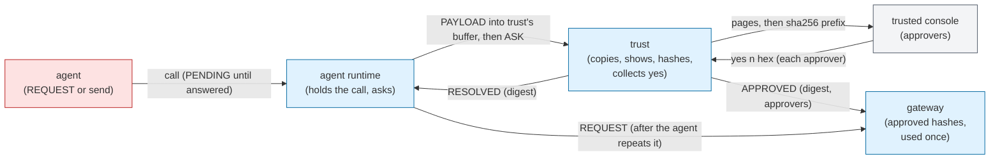

# Payload approval, four eyes, and timeouts

## 1. Status

- **Design:** **Accepted**: approved by the maintainer on 2026-11-27 (#323), with each open question decided as recommended (section 7). It follows [D-037](../project/decision-log.md#d-037-payload-approval-and-risk-routing) (accepted 2026-11-27) and builds on the [egress gateway](gateway.md), the [identity model](identity.md), and the `send` tool ([tools.md](tools.md)).
- **Implementation:** **implemented**: the payload display, `ASK`, and `send` on it (#324); the gateway's check (#325); the marks, the runtime's asking for HTTPS requests, and two approvers (#326); the timeouts (#327); and the `approval` test kernel (#328). *As built* notes in section 3. **Planned:** a role narrowing who approves a route (open question 5), and the whole digest in the trail (M6.7, open question 4). The gate is #329.

## 2. Context

An approver should see the exact bytes an action sends. D-037 decided the parts:
- `trust` shows every byte, escaped, prefixed, and paged;
- the approval names the SHA-256 of the bytes shown, and is checked where the bytes leave;
- the approver types `yes <n>` with the hash's first 8 hex digits;
- compiled policy marks each gateway route `none`, `one`, or `two`, and `send` needs at least `one`;
- `two` means two distinct people, neither the requester;
- no answer denies.

What exists today (M6.5, checked at `9731b39`):
- **`send`:**
  - the runtime keeps a copy of the call and asks `trust` with `CONFIRM`, which carries the agent, the task, the destination, and the size;
  - `trust` writes `confirm #<n>: ...` from those fields, and the agent's call answers `PENDING` until the user types `yes <n>` or `no <n>`, or 60 s pass (`APPROVE_US`);
  - the agent repeats the same call to learn the outcome, and a different call is `BUSY`.
- **The gateway's `REQUEST`:**
  - checks the grant, records the intent (with 8 bytes of SHA-256 over `target ‖ 0 ‖ body`), and sends;
  - its whole request is bounded at 30 s, and the runtime waits 35 s;
  - a route's `max_body` is 4 KiB by default, and at most 60 KiB.
- **Messages and `trust`:**
  - IPC messages are at most 256 bytes, so a payload cannot travel in one;
  - `trust` reads lines of at most 64 bytes and writes lines of at most 256;
  - `trust` knows each agent's owner from `REGISTER` (#311) and who is logged in (#310);
  - `trust` holds no capability on the gateway.
- **Audit:** actions `APPROVE` (5), `REFUSE` (6), and `EXPIRE` (7) already exist.

## 3. Design

### Overview



An approval finishes before the request reaches the gateway. A `two` approval can take 10 minutes, and the gateway's 30 s budget runs only from when it takes the request. This is how `send` already works: the call is held, the agent repeats it, and only an answered call goes on.

### What is approved

The *approved bytes* are what `trust` shows and hashes. The *digest* is SHA-256 over them:

| Action | Approved bytes | Shown as |
| --- | --- | --- |
| `REQUEST` | `route ‖ 0 ‖ target ‖ 0 ‖ body`, where the target is the path and query | a header line naming the route and the method, then the target and the body, paged |
| `send` | `address:port ‖ 0 ‖ data` (the destination as `net` writes it) | a header line naming the destination, then the data, paged |

The route's name is in the digest because the route fixes the host, the method, the secret, and the headers. The bytes the gateway writes beyond the approved ones (`Host`, `Content-Length`, the secret's header, and the fixed headers) come from the compiled route, which is reviewed with the image. They are not shown: they are the same on every request.

### Marks

- **Gateway routes:** `Route` gains `approve: Approve` (`None`, `One`, or `Two`), with `None` the default, so every existing route stays grant-only. Host tests over every table refuse (`check_routes` and `trust_approves`; `pharos_services::check` itself does not, M6.4 review G1):
  - a marked route whose `max_body` plus its longest target is over the largest approvable payload (open question 1);
  - a marked route in a table without `trust`'s capability on the gateway.
- **`send`:** always `One`.
- **The manifest may ask for more:** the optional key `approve = <route>:<one|two>,...` raises a route's mark for that agent and never lowers it. A route the agent has no grant for, a lower mark, or an unknown mark is refused at parse or by `Manifest::within`.
- **Where each mark is enforced:** the runtime uses the higher of the route's and the manifest's marks when it asks. The gateway enforces the route's own mark, so a runtime that asks for fewer approvers is refused there. Only the runtime enforces a mark the manifest raised.

### Getting the payload to `trust`

1. **The buffer:** at start, `trust` maps one 8 KiB buffer and gives the runtime `WRITE` on it (`ATTACH`, as the gateway's clients do). The runtime attaches it again on `NO_BUFFER`, after either one restarts.
2. **The request:** the runtime writes the approved bytes at offset 0, then sends trust v1 `ASK`: `[version, op, number (2), name length, name, task (4), kind, approvers, length (2)]`. `kind` is 1 for `REQUEST` and 2 for `send`. `approvers` is 1 or 2.
3. **The copy:** `trust` copies `length` bytes into its own memory at once, checks that the bytes parse as `kind` says (two zero bytes for `REQUEST`, one for `send`), and clears the buffer. Everything after works on the copy, so a later write by the runtime changes nothing that was shown or hashed.

`CONFIRM` stays for its old prompt only until `send` moves to `ASK` (#324). Then it is removed, with its prompt.

*As built (#324):*
- The buffer is 4 KiB (`trust::MAX_PAYLOAD`), the largest approvable payload (open question 1), not 8 KiB. `trust` maps it at start. *Since #326:* the runtime asks for it before each ask with trust v1 `BUFFER` (15), a `call` that `trust` answers on the reply with `WRITE` on the buffer; the runtime maps it, writes, and unmaps it. #324 had `trust` give it with agents v1 `ATTACH` after each `CHANNEL`, retried every 100 ms. But a non-blocking send reaches the runtime only while it waits in `receive`, and a busy runtime, between gateway calls or with an agent's request queued, never does: in the `vault` kernel the buffer never arrived. A reply always lands, and asking each time means a restarted `trust`'s buffer is the one written.
- `ASK` is trust v1 op 14. Op 9 (`CONFIRM`) is gone. `trust` refuses an ask whose bytes do not parse as its kind (`approval::parts`), and, until #326, an ask for two approvers.
- The digest goes back in agents v1 `ANSWER`, which carries 32 more bytes for an ask approved, not in `RESOLVED`, which runs the other way. The runtime takes a yes for a call only with a digest equal to its own copy's, and a permission's only with none (`approval::holds`).
- Pages bypass the rate limit on lines the runtime's messages make, and each line waits up to 100 ms for a transmit buffer. A page with a line the console could not take ends there, with `ask #<n>: the console was full; show <n> again` and no hash line.
- `yes <n>` without digits on an ask says to type them. The answer rules are `approval::check_yes`. The approval is recorded `APPROVE` with `ask #<n> <8 hex>`, and a refusal `REFUSE` with `ask #<n>`.
- The runtime asks only for `send` so far. Gateway requests follow with the gateway's check (#325) and the marks (#326). *Since #326 it asks for both.*

### The display

`trust` writes everything itself, from the copy and the fields.

```text
ask #3: fetcher task 7 (owner admin) wants an HTTPS request on route issues, 2 approvers
| 0000 issues\x00/repos/ac
| 0010 me/demo/issues\x00{
| 0020 "title":"Disk fu
| 0030 ll on build-3","
| 0040 body":"C:\\logs\x0a"
| 0050 }
#3: 81 bytes, sha256 ada84318; yes 3 ada84318 / no 3
```

- Each line shows 16 approved bytes (32 in the design as accepted; 16 since the M6.4 review, F7), as `| `, the offset in 4 hex digits, a space, and the bytes. Printable ASCII (0x20–0x7e) is written as itself, except `\`, which is written `\\`. Every other byte is written `\xNN`. So the longest line is 7 + 16 × 4 = 71 bytes, which fits an 80-column terminal without wrapping, and nothing in a payload can end a line or write a control sequence.
- No line of `trust`'s own starts with `| `, so payload text cannot pass for a prompt, a name, or an answer.
- 16 lines (256 bytes) make a page, so a 4 KiB payload is 16 pages. `more <n>` shows the next page, and `show <n>` shows the first again.
- The hash line comes only after the last page. It gives the length, the first 8 hex digits of the digest, and the answers.
- The header line names the agent and its owner (from `REGISTER`), the route (from the request; the route's name is in the digest, so a lie here is refused at the gateway). *As built:* not its method, which `ASK` does not carry and the compiled route fixes (M6.4 review F5), and how many approvers are needed.

### Answers and approvers

- **`yes <n> <8 hex>`** is refused, and says why, unless:
  - someone is logged in;
  - this person has been shown the hash line of `<n>` since their login;
  - the digits match the digest's first 8;
  - for `two`: the person is not the requester and has not already approved `<n>`.
- **`no <n>`** needs only a login, and denies at once.
- **The requester** is the agent's owner. No person submits tasks today (tasks come from control clients and from agents), so no other person can be the requester. When a person can submit a task, that person becomes its requester.
- **Two approvers** log in one after the other at the one console. A `yes` stays given after its approver logs out. Each `yes` is recorded when it is typed, and the console shows `ask #3: approved by bob, 1 more needed`.
- **When enough people have approved:**
  1. for `REQUEST`, `trust` sends the gateway `APPROVED` (below) and waits up to 1 s for its answer, and a failure denies;
  2. `trust` sends the runtime `RESOLVED` with the digest;
  3. the runtime checks the digest against its own copy and answers the agent's next repeat of the call by going on (`REQUEST` to the gateway, or the datagram), or by refusing it if the digests differ.

### The gateway's check

- **The capability:** `trust` gets `SEND` on the gateway as a new client, badge 3 (`init`'s table gives it, as for the vault's client).
- **`APPROVED`:** gateway v1 op 2, `[1, 2, route:u8, approvers:u8, digest (32)]`, from client 3 only. The answer is `OK`, `NOT_FOUND`, or `BUSY`.
  - The gateway keeps at most 4 approvals. Each is used once and expires 60 s after it arrives (open question 3).
  - A fifth is `BUSY`, and `trust` denies it.
- **On `REQUEST` for a marked route:** the gateway computes the digest of the request it was given and looks for an approval with that route and digest, with `approvers` at least the route's mark.
  - None found: status 45 `NOT_APPROVED` (`status::OWN + 13`), recorded as a refusal, before any release or connection.
  - Found: the approval is removed, then the request goes ahead, with `approved <8 hex>` in the intent's record.
- **On restart** the gateway keeps no approvals, so a request approved before it restarted is refused.

*As built (#325):*
- `APPROVED` names its route by name, as `REQUEST` does: `[1, 2, name length, name, approvers, digest (32)]`. `trust` does not know which table `init` runs, so it cannot number routes. A badge other than 3 is refused `NO_ACCESS`. A route not in the table, or not marked, is `NOT_FOUND`.
- The table is `pharos_programs::gateway::Approvals`, host-tested: kept only if `room` allows (`NOT_FOUND`, `BUSY`) and only once recorded (`approval <route> <8 hex> by <k>`); used once, by digest, route, and at least the mark's approvers; expired after `gateway::APPROVAL_US`.
- The use is a record of its own before the intent, `approved <route> <8 hex>`, not part of the intent's detail, whose 64 bytes are already full. A refusal is `c<client> <route> status 45`.
- `Route::approve` (`pharos_services::Approve`: `None`, `One`, `Two`), `None` on every route but the `vault` table's `approved`. `check_routes` refuses a marked route whose longest approved bytes (`longest_request`) are over 4 KiB (`BrokenRoute::Approvable`). A host test requires every table with a marked route to give `trust` `SEND` on the gateway with badge 3 (`trust_approves`), and in tables 11 and 12 it is `trust`'s handle 7.
- `trust` sends `APPROVED` for an HTTPS ask before it answers the runtime, and waits up to 1 s for `OK`. Otherwise it says `the gateway did not take the approval; nothing approved`. Until the runtime asks for HTTPS requests (#326), no HTTPS ask reaches `trust`. The `vault` kernel checks the refusal side: `fetcher`'s request on `approved`, which the runtime passes on, is `NOT_APPROVED` from the gateway, with no release and no intent in the trail. Mutation-checked: with the gateway's check off, `vault` fails.
- A manifest may now list 8 routes (`manifest::MAX_ROUTES`), so `fetcher` holds `approved` beside its four. Files, channels, and knowledge scopes stay at 4.

*As built (#326):*
- **The runtime learns a route's mark from the gateway:** gateway v1 `MARK` (op 3), `[1, 3, name length, name]`, answered `[OK, approvers]`, or `[NOT_FOUND]` for a route the table lacks or the client may not use, and recorded nowhere. The runtime cannot read the route table itself, as it does not know which table `init` runs. It asks before every `REQUEST`; no answer within the request's own wait (35 s) is `BUSY`. It was 1 s in #326, which failed the `vault` kernel's request after the gateway's restart under the full suite's load; a `REQUEST` alone had waited. The approvers it asks for are the higher of the mark and the manifest's. A runtime that skips this or asks for fewer is still refused at the gateway.
- **The manifest's `approve` key:** `approve = <route>:<one|two>, ...`, each a route of its `https` list, at most once (`Manifest::approvers`). The runtime keeps the marks beside the entry's route names. It raises a mark; the gateway enforces the route's own.
- **A marked request is held as `send`'s call is:** `approved_call` keeps the approved bytes (`route ‖ 0 ‖ target ‖ 0 ‖ body`) in the slot's `Confirm`, answers `PENDING` while the agent repeats the request, `BUSY` for another, and `REFUSED` for a no or no answer. Only then are the budget charged and the intent recorded, and the request goes to the gateway, which uses the approval `trust` sent it. `Confirm::data` now holds the approved bytes for `send` too, and the digest check compares them.
- **Two approvers in `trust`** (`approval::may_approve`, host-tested): for two, distinct people, neither the agent's owner from `REGISTER`, and no one at all while `trust` does not know the owner. Each person must be shown the hash line since their own login, so a second approver logs in and types `show <n>`. A yes short of the count shows `ask #<n>: approved by <name>, 1 more needed`. Only the last one sends `APPROVED` (with the count) and answers the runtime; if either fails, that yes is taken back. A yes refused because its author is the requester, or approved before, is recorded as `approve`, outcome refused, `ask #<n> <8 hex> requester` (or `again`).
- **`trust`'s reply buffer:** `call_timeout` copies the request into the reply buffer first, so a 16-byte one refused the 44-byte `APPROVED` (`TOO_LARGE`) before it was sent. It is 256 bytes, as for `trust`'s other calls.
- **The `vault` kernel** runs it end to end. `fetcher`'s request on `approved` (one) is shown on the console; the runner types `show 1`, since the ask may arrive before its login, and then `yes 1 <digits>`. The gateway keeps the approval, `approved approved d4c4efdc` is recorded before the intent, and the server answers 201. The same bytes from `agentclient` 17 as gateway client 2 are then `NOT_APPROVED`: the approval was used once. On `two`, `admin`'s yes is refused as the requester, `no 2` refuses it, and nothing of it reaches the gateway. The 10 minutes for two approvers (`APPROVE_US` for both until #327), and two people approving on the console, are the `approval` kernel's (#328).

### Timeouts and failures

Each of these denies, and each is recorded:

| Event | Outcome |
| --- | --- |
| No decision within 60 s (`one`) or 10 min (`two`), timed by the runtime as today (`APPROVE_US`, a second value for `two`) | `EXPIRE` |
| A `no` from any logged-in person | `REFUSE` at once |
| `trust` restarts | the runtime denies every pending call when `trust` registers again (`CHANNEL`) |
| The runtime restarts | every attempt restarts, and the pending calls go with them |
| The gateway restarts, or `APPROVED` fails | the request is refused (`NOT_APPROVED`, or `trust` denies it) |
| The agent repeats a different call | `BUSY`, as for `send` today |
| The agent never repeats the call | the gateway's approval expires unused |

One call waits per task, and at most 4 per runtime (`MAX_PENDING`), so a flood of calls asks the console at most four times at once.

*As built (#327):*
- The timeout is `approval::timeout_us`: 60 s for one approver and 10 min for two, or 5 s and 40 s (10 s before #328, 20 s before the M6.4 review, as the `approval` kernel adds a person and logs in three times) with the test policy tables (the runtime's arguments 1 and 5), host-tested. The runtime sets each ask's deadline by its approvers, and a permission's approval keeps one approver's.
- **A logout does not deny.** The issue's text (#327) asked that a logout or an idle session end deny a pending ask. The design keeps a yes given after its approver logs out, and two approvers at one console can only take turns. So a logout, or an idle end, only takes away "shown since their login" (each ask's `seen`); the next person must read it again. The deadline still bounds every ask.
- **A restarted `trust`** is not given the runtime's `CHANNEL` again, so it cannot answer; it knows none of the asks before it, and ignores their `RESOLVED`. Each ask ends at its deadline as `EXPIRE`, denied: not at once, as section 3 had it, but within the timeout. A restarted runtime's `CHANNEL` makes `trust` drop every ask it shows (`ask #<n>: the runtime ended`, #324), and a restarted gateway holds no approvals (#325), so an approved request after it is `NOT_APPROVED`.
- The kernel tests of each, with timeouts the kernel shortens and `trust` and the gateway killed, are the `approval` kernel's (#328).

### Audit

| Record | By | Contents |
| --- | --- | --- |
| The ask | runtime | agent, task, kind, route or destination, length, digest prefix, approvers needed |
| Each answer | `trust`, actor the person | `APPROVE` or `REFUSE`, `ask #<n> <8 hex>`, and `requester` when a `yes` is refused for that reason |
| Expiry | runtime | `EXPIRE`, `ask #<n>` |
| The approval stored, and its use | gateway | `approved <route> <8 hex> by <k>`; the intent then carries `approved <8 hex>` |
| A refusal at the gateway | gateway | `NOT_APPROVED`, the route, the digest prefix |

No payload byte reaches the trail, only its length and its digest. The trail shows who approved what and when. An auditor holding the payload can check it against the digest prefix, and with the full digest when the trail's records allow it (open question 4).

### Budgets

- `trust`: the 8 KiB buffer, one 8 KiB copy for each of 4 pending asks, and the approvers (at most 2 names each). That is about 48 KiB.
- The gateway: 4 approvals of 34 bytes each.
- Approvals a task needs are counted in the demo scenarios and held to a budget at the gate (#329). This counts against approval fatigue.

### Since the M6.4 review

[review-m6.4-approval.md](../security/review-m6.4-approval.md):
- `ASK` carries the runtime's deadline (`wait_ms`), and `trust` ends each ask then itself (F3).
- An ask approved and told to the runtime takes no further yes, and the gateway replaces an approval of the same route and bytes rather than keeping two (F2).
- The gateway takes an approval for any route its table has, so a manifest's `approve` on an unmarked route can be approved (F4).
- Each ask's first line is written with every first page and never dropped (F5).
- A login or logout sets each ask back to its first page (F6).
- Lines are 16 bytes (F7).
- A `trust` with no channel to the runtime refuses every yes at once and tells the gateway nothing (F9).
- A two-approver ask refuses a person whose passphrase someone else set since `trust` started, until they set their own (F1).
- `MARK` waits as long as a request (35 s), not 1 s: found by the gate's own run, on a gateway slow to restart.

## 4. Security

- **The bytes sent equal the bytes shown.** `trust` hashes its own copy, the one it shows. The gateway hashes the request it is about to send and refuses any other. A runtime that writes one payload to `trust` and gives the gateway another is refused at the gateway.
- **The agent cannot shape the prompt.** Payload lines are escaped and prefixed, so no payload line looks like one of `trust`'s. Names are checked names (`valid_name`). The hash line comes from `trust` alone.
- **The approver reads to the end.** `yes` needs the digits from the hash line, which only follows the last page. An approval mistyped against another `#<n>` does not match that request's digest.
- **Four eyes:** two different logged-in people, and the owner (the requester) can be neither. *Since the M6.4 review (F1):* anyone logged in may add a person or set another's passphrase (D-038, the M6.5 review's F3), then log in as them. So a two-approver ask refuses a person whose passphrase someone else set since `trust` started, until they set their own. **Limit:** `trust` keeps that list in memory, so a passphrase set before `trust` restarted counts again once a restarted runtime lets `trust` approve.
- **Limits:**
  - for `send`, the runtime is the sender, so a compromised runtime can send unapproved data (D-037's consequence) until `send` moves behind a service of its own;
  - a compromised runtime can lie about an agent's owner (M6.5 review F11), and so about who the requester is;
  - the route's fixed headers and host are not shown (they are compiled and reviewed);
  - a payload over the largest approvable size cannot be approved at all.

## 5. Testing

| Where | What |
| --- | --- |
| Host | The escaping, line, and page layout, with every byte value, `\`, and the longest line; the digest of both kinds; the `ASK` and `APPROVED` codecs (fuzzed like the other interfaces); manifest `approve` parsing and `within`; `check` refusing a marked route too large to approve; the answer rules (each refusal reason) on `pharos_programs` state, host-tested |
| QEMU, `approval` (#328) | **Implemented.** `init` table 13 (the `vault` table's services and routes, the runtime on policy table 5, `fetcher` with the short timeouts) and `agentclient` 20. The runner seeds `bob` and `carol` beside `admin`, starts the `vault` kernel's HTTPS server, and plays `APPROVAL_SCRIPT`: `a` (one approver) shown, `show` and its digits, sent; `b` (two) refused as `admin`'s, the requester's, then as `dave`'s, whom `admin` just added (M6.4 review F1), then `bob`'s yes refused until he reads it after his login, his second refused, and `carol`'s; `c` (two) unanswered, refused at the 40 s deadline (20 s before the M6.4 review); `d` shown while no one was logged in, a yes refused until `show`; `e` approved, then changed by the agent to `f`, asked anew and refused. The client then sends `f` to the gateway itself as client 2 (`NOT_APPROVED`), `e` (sent: it was approved) and `e` again (`NOT_APPROVED`, used once). The kernel kills `trust` at the client's cue; the restarted `trust` shows `g`, the runner approves it, the gateway keeps it, and `trust` cannot tell the runtime (`answer: the runtime is not answering`): the ask is denied at its deadline. The runner checks the server received `a`, `b`, `d`, and `e` once each and never `c`, `f`, or `g` (it logs the first 16 hex digits of each POST body's SHA-256), and the trail: each answer by its person, the requester's and the repeated yes refused, the approvals kept by count and used. Mutation-checked: a gateway that adds a byte to an approved body fails it |
| CI | **Implemented (#329).** `approval` on `main` (run 46056881506); a throwaway branch where the gateway sends a body other than the approved one failed `approval` (run 46147617447) |

## 6. Alternatives

- **The approval inside the gateway's request:** simpler messages, but the gateway would wait up to 10 minutes per request with a TLS connection open, against its 30 s bound.
- **The runtime keeping the digest alone:** taken for `send` only, as its limit. For `REQUEST`, D-037 puts the check where the bytes leave.
- **Payload in IPC messages:** at most 256 bytes each, so a 4 KiB body would be about 20 messages, with ordering and loss to handle. The shared buffer is one copy.
- **`trust` reading the route table for marks:** `trust` would need the table's number, as the vault and gateway take it. The gateway enforces the route's mark anyway, so the runtime's claim cannot lower it.

## 7. Open questions

**Decided (2026-11-27, #323):** 1. at most 4 KiB approvable, a marked route that could exceed it refused at build; 2. 16 lines of 32 bytes a page; 3. the gateway keeps an unused approval 60 s; 4. the digest's first 8 bytes in the trail, the whole 32 with a longer record (M6.7); 5. a role narrowing approvers planned, not built; 6. `send` moved to `ASK` now, `CONFIRM` removed.

1. **The largest approvable payload:** 4 KiB (8 pages), refusing a marked route whose `max_body` could exceed it, or 16 KiB (32 pages)? Recommended: 4 KiB. A payload no one reads to the end is not approved in any real sense.
2. **Page size:** 16 lines of 32 bytes, or a whole payload at once? Recommended: 16 lines, so a page fits a terminal and `more` is a deliberate step.
3. **How long the gateway keeps an approval:** 60 s, or the request's 30 s? Recommended: 60 s. The agent may be slow to repeat its call, and the approval is used once anyway.
4. **The digest in the trail:** the first 8 bytes in hex (as the intent today), or the whole 32? Recommended: 8 bytes in the 64-byte record, and the whole digest when a longer record exists (M6.7). 8 bytes already bind the approval to its intent.
5. **A role narrowing who may approve a route:** built now, or planned? Recommended: planned. D-037 allows it, but no route needs it yet.
6. **`send` moved to `ASK` now:** or keep `CONFIRM` and add payload pages to it? Recommended: move it, so there is one approval path to review.

## Implementation issues

#324 (the display and `ASK`), #325 (the gateway's check), #326 (marks and two approvers), #327 (timeouts), #328 (the `approval` kernel), #329 (the gate).
