# The foreign-agent bridge (Tier 3)

## 1. Status

- **Design:** **Accepted**: approved by the maintainer on 2026-11-24 (#295), with each open question decided as recommended (section 7). It follows [D-036](../project/decision-log.md#d-036-foreign-agent-bridge) (accepted 2026-11-24) and builds on the [agent runtime](agents.md) and the [egress gateway](gateway.md).
- **Implementation:** the guest image is **implemented** (#296): `cargo xtask guest`, pinned by `xtask/guest.lock`, with a boot check in place of the agent (*as built* below). The channel and the launch tool are **implemented** (#297). The bridge service, `BIND`, the frames, and the driver's buffer sizes as parameters are **implemented** (#298), with a new `derive` system call (*as built* below). The `channel` test kernel shows them end to end: a guest agent's task, bound, logged, and completed through the bridge. The client library and the LangGraph agent are **implemented** (#299). The `bridge` scenario and the hostile-guest suite are **implemented** (#300): the `bridge` test kernel, which replaced `channel`, in CI under KVM (*as built* in section 5). **Planned:** `cargo xtask run` with a guest. The M6.3 gate passed on 2026-11-25 (#301), with its [security review](../security/review-m6.3-bridge.md).

## 2. Context

M6.3 runs an agent written for an unmodified framework (LangGraph, D-036 item 6) in a Linux guest. The guest has no network device and no credentials, and reaches nothing but the Pharos runtime. D-036 decided the parts:
- the channel is a virtio-serial port on each VM, joined by one host unix socket, with no relay program;
- a launch tool writes both QEMU command lines, refuses any other configuration, and checks the result through QEMU's monitor;
- a Pharos service parses the guest's frames and speaks for it as one agent slot, under a Tier 1 agent's grants, budgets, approvals, and audit;
- the guest is pinned Alpine as an initramfs, with a scripted model until M6.9.

It left to this design how the service holds the slot, the frames, the guest image and client library, the launch tool's checks, failures, limits, and records.

Facts this design relies on (checked 2026-11-24):

- **An agent holds one capability:** `SEND` on the runtime's endpoint, badged with its slot. The runtime spawns its program, registers its `STOP` with `trust`, and serves its requests only after that (agents.md). The runtime checks each request against the agent's grants and budgets and records it first (`NO_AUDIT` otherwise).
- **`spawn` passes at most 12 capabilities**, and the runtime already uses all 12 (handle 12 is the gateway or the proposals' store namespace, gateway.md). So the runtime cannot be given the guest's device to pass on.
- **Kernel revocation** marks every capability derived from the revoked one, and each fails its next use (capabilities.md).
- **The virtio-console driver** (`pharos_programs::virtio_console`) negotiates `VERSION_1` only, with no multiport, so it uses port 0. Its buffer sizes are constants (16 × 64 bytes in, 16 × 256 out). `init` hands devices out by ID and position (`device(VIRTIO_CONSOLE, 0)` is `trust`'s).
- **`cargo xtask` writes each QEMU command line itself.** The trusted console is a `virtio-serial-pci` with a `virtconsole` on a pipe.

## 3. Design

### Overview

```mermaid
flowchart LR
    classDef kernel fill:#1e3a5f,stroke:#0f1f33,color:#ffffff
    classDef service fill:#eceff1,stroke:#607d8b,color:#1c262b
    classDef untrusted fill:#ffe5cc,stroke:#e65100,color:#4a1d00
    classDef host fill:#f3e5f5,stroke:#6a1b9a,color:#2a0a3a

    subgraph guestvm["guest VM (Linux, no network, no disk)"]
        agent["LangGraph agent<br/>+ pharos_bridge.py"]:::untrusted
    end
    sock["host unix socket<br/>(two QEMUs, no relay)"]:::host
    subgraph pharos["Pharos VM"]
        bridge["bridge service<br/>(frames, one slot)"]:::service
        runtime["agent runtime<br/>(grants, budgets, approvals)"]:::service
        audit["audit service"]:::service
        gw["gateway, store, ..."]:::service
    end
    launch["cargo xtask<br/>(launch tool, QMP checks)"]:::host

    agent -- "virtserialport" --> sock
    sock -- "virtconsole (2nd virtio-serial)" --> bridge
    bridge -- "agents v1, badged with the guest's slot" --> runtime
    runtime --> audit
    runtime --> gw
    launch -. "writes and checks both VMs" .-> guestvm
    launch -.-> pharos
```

The guest sees one named port. Everything it says arrives at the runtime as an agent's request from the guest agent's slot, and is checked, budgeted, approved, and recorded as any Tier 1 agent's is. The bridge holds the device and a capability for one slot at a time, nothing else.

### Components

| Component | Holds | Never holds |
| --- | --- | --- |
| Guest VM | One `virtio-serial-pci` with one `virtserialport` named `org.pharos.bridge`; its kernel and initramfs in RAM | A network device, a disk, a shared filesystem, a second port, any credential |
| Host | The socket, both QEMUs, their monitors, the guest image | Any parse of the frames |
| Bridge (new, started by `init`) | The second virtio-console device (`device(VIRTIO_CONSOLE, 1)`); `SEND` on the runtime under the bridge badge; while bound, `SEND` on the runtime badged with the guest agent's slot | An audit, store, network, gateway, or inference capability; any other device |
| Agent runtime | The guest agent's policy entry and manifest, as for any agent; one new operation, `BIND` | The guest's device |
| `trust` | As in M3.3 | Anything new |

### The slot: `BIND`

How the bridge holds the slot is D-036's open point. The runtime cannot spawn the bridge (it cannot hold the device), so the bridge asks for the slot:

1. **The policy entry marks the agent as a guest** (`guest: true`, in a compiled table only). The runtime starts no program for it. When one of its tasks starts an attempt, the attempt waits for the bridge.
2. **The bridge calls `BIND`** (a new agents v1 operation, accepted only under the bridge badge that `init`'s table gives it, `NO_ACCESS` from anyone else). If an attempt is waiting, the reply carries a capability: `SEND` on the runtime, badged with the guest agent's slot, minted for this attempt. Otherwise it answers `NOT_FOUND` and the bridge asks again a second later.
3. **The bridge then speaks only through that capability.** Every guest request is an agent's request from that slot. The runtime has no new request path, so grants, budgets, approvals, refusals, and records are unchanged.
4. **The attempt ends as any attempt does:** `COMPLETE`, `FAIL`, `CANCEL`, a revocation, or the user's `stop`. The runtime then **revokes** the minted capability, so the bridge's next send fails, and the bridge goes back to step 2. Each attempt gets a new capability, so nothing from one attempt reaches the next.
5. **A second `BIND` while one is held** (a restarted bridge) revokes the first and ends its attempt as failed (`bridge restarted`), which counts against the task's attempts like an agent's crash.

*As built (#298):*
- **The kernel had no way to mint the capability.** `send` is a rendezvous, so the runtime cannot send itself a badged capability, and no call derived one in place. Approved by the maintainer on 2026-11-24: a new system call, `derive` (35, [syscalls-ipc.md](syscalls-ipc.md#system-calls-in-m27)). It gives the caller a child of a capability it holds with `GRANT`: never more rights, and a badge only if the parent has none. The runtime derives `SEND | GRANT` on its endpoint with the slot's badge, and passes it with `SEND` alone on `BIND`'s reply. Revoking it reaches the bridge's copy and nothing else. It is a narrow addition to D-036's design, not a new authority: passing a capability already derived a child the same way.
- `guest: true` is a policy entry field (`pharos_proto::manifest::Entry`), compiled only. The entry's manifest is read and checked as any agent's. Its `program` names the guest's, which the runtime never opens.
- A guest's attempt is registered with `trust` with no process. The runtime records `bind` before it replies, and `unbind`, with the reason (`attempt ended`, `hung`, `cancelled`, `stopped`, `bridge restarted`), when it revokes.
- *M6.3 review (#301, [review-m6.3-bridge.md](../security/review-m6.3-bridge.md) F1, F2):* **the badge names the attempt, not the slot.** Revoking reaches only what was derived from the capability, so it cannot reach a request already queued (the kernel copies the badge at `send`), nor the bridge's copy once the runtime that minted it is gone (`init` gives a restarted runtime the same endpoint). With the slot's badge, either reached whatever held the slot next, another agent included. So each attempt's capability has its own badge, `agents::guest_badge` (`0x80_0000`, the task's low 15 bits, and the attempt), never an agent process's. The runtime serves it only while that attempt is bound and answers any other `NO_SESSION`, which the bridge takes as the attempt's end. Attempt numbers are stored and grow at every start, so a restarted runtime does not mint an earlier badge until task IDs pass 32,768 more. The bridge also zeroes its buffer at each attach, so a reply's gaps carry nothing of an earlier attempt (F3).
- `trust`'s `stop <agent>` for a guest sends `STOP_GUEST` (an agents v1 request under `trust`'s badge, non-blocking for at most 2 s). It stops the runtime if that is not taken. `stop all` stops the runtime first, as before, which ends a guest's attempt with it.

**Stopping a guest agent:** a guest agent has no process for `trust` to `STOP`. `trust`'s `stop <agent>` for it is sent to the runtime as `CANCEL`, which revokes. If the runtime doesn't answer within 2 s, `trust` stops the runtime, which ends every agent and leaves the bridge's capability without an endpoint. This fails closed, but the runtime is in this path, unlike a Tier 1 agent's stop (open question 1).

### The channel

- **Pharos side:** a second `virtio-serial-pci` with a `virtconsole` (port 0, so the existing driver works without multiport), on `-chardev socket,id=bridge,path=<short path>,server=on,wait=off`. It comes after the trusted console in PCI order, so `trust` keeps device 0.
- **Guest side:** one `virtio-serial-pci` with one `virtserialport,name=org.pharos.bridge` on `-chardev socket,id=bridge,path=<same path>`. Linux shows it as `/dev/virtio-ports/org.pharos.bridge`. It is not a `virtconsole`, so no getty or kernel console runs on it.
- **The driver** takes its buffer counts and sizes as parameters (D-036). The bridge uses 16 receive buffers of 4 KiB; `trust` keeps 16 × 64 and 16 × 256.
  - *As built (#298):* the sizes only (`virtio_console::Sizes`, each a power of two from 64 to 4,096 bytes); both users take 16 buffers. The bridge uses 4 KiB each way.
- **The socket path** is relative to the run's directory and under Linux's 108 bytes.
- *As built (#297):*
  - `xtask/src/bridge.rs` writes both sides. Pharos's VM gets `virtio-serial-pci,disable-legacy=on,iommu_platform=on` after all its other devices, `-chardev socket,id=bridge,path=bridge.sock,server=on,wait=off`, and `virtconsole,chardev=bridge`, plus QMP. Both QEMUs run in the run's directory, so `bridge.sock` is a short relative path; `xtask` reaches the QMP sockets through `/proc/self/fd/<dir>/`, for the same reason.
  - **Pharos's firmware takes the channel as a console.** OVMF drives every virtio-console, so a guest connected during the firmware read its boot output (found by the `channel` kernel). It could probably also have typed into the firmware's menus; that was not tried. So the launch tool starts the guest only once Pharos has printed a line saying its own driver holds the device (`channelprobe: waiting for the guest` in #297; `bridge: ready` since #298). Until then no client is on the socket, and QEMU drops what the firmware writes. Pharos's QEMU runs with `-no-reboot`, so a reset, which would run the firmware again, ends the run instead.
  - The `channel` kernel's probe (`bin/channelprobe`, table 12) used the trusted console's driver unchanged. The bridge service replaced it in #298, and the launch tool now waits for its `bridge: ready` line.

### Frames

The channel is a byte stream. The bridge frames it, and parses every frame as untrusted input, in safe Rust (`pharos_proto::bridge`, host-tested and fuzzed).

| Field | Size | Rule |
| --- | --- | --- |
| Magic | 2 | `PB` |
| Version | 1 | 1 |
| Kind | 1 | 1 `HELLO`, 2 `REQUEST`, 3 `REPLY`, 4 `ERROR` |
| Length | 4, little-endian | Of the payload, at most 70,000 |
| Payload | Length | Per kind |

- **`HELLO`:** the bridge sends one when it binds: the task ID and the attempt. The guest answers with the same payload. Until it does, the bridge discards bytes up to 64 KiB looking for it (resynchronizing after a previous attempt), then fails the attempt (`guest silent`).
- **`REQUEST`** (guest to bridge): `message length:u8`, an agents v1 agent message as an agent would send it (at most 256 bytes), then the data the operation reads from the agent's buffer (at most 68 KiB, the agent buffer's size).
- **`REPLY`** (bridge to guest): the runtime's reply message, then the bytes the operation wrote to the buffer, which the bridge takes from the reply's length fields.
- **`ERROR`** (bridge to guest): a status byte and a reason, then the bridge closes the attempt. It is sent for a malformed frame, a second `REQUEST` before the `REPLY`, or an operation not on the list below.

**Operations the bridge passes:** `TASK`, `LOG`, `CHECKPOINT`, `BEGIN`, `END`, `COMPLETE`, `FAIL`, `REQUEST` (HTTPS), `DATA_PUT`, `DATA_GET`, `ASK`, and `INFO`. The bridge attaches its own buffer (`ATTACH`), since a frame cannot carry a capability. Inference, tools, messages, knowledge, and subtasks are not passed in M6.3 (open question 2). The runtime still checks each passed operation in full; the bridge's list only keeps it from parsing layouts it doesn't need.

**One request at a time.** The guest waits for each `REPLY`, so the bridge needs no queue.

*As built (#298):* `pharos_proto::bridge` holds the header, a byte-at-a-time `Decoder` (which finds only `HELLO` until the bridge accepts one), `parse_request`, and `reply_len`. A `REQUEST`'s buffer bytes must be exactly what its operation reads, and go where it reads them: at `CHECKPOINT_AT` for `CHECKPOINT`, otherwise at 0. A `REPLY`'s buffer bytes start at 0. `TASK` carries the input, or the input and checkpoint if there is one (`CHECKPOINT_AT` plus its length); `DATA_GET` carries the file; `REQUEST` carries the content type and the answer. Every other operation, and any refusal, carries none. The bridge sees a second request before the reply only when its bytes come in the same receive buffer as the first's end. A guest's `FAIL` ends the attempt as an agent's does. The bridge sends the guest's protocol errors and silence to the runtime as the agent's `FAIL` with the reason, so they end the task (not just the attempt) and are recorded as its failure.

### Failure

Every failure ends the attempt or the request and leaves nothing open:

| Event | Result |
| --- | --- |
| A malformed frame (magic, version, kind, length, a message over 256 bytes) | `ERROR`, the attempt fails (`guest protocol`), recorded by the runtime as the task's failure |
| The guest sends nothing for 60 s during an attempt, outside a pending `REQUEST` | The attempt fails (`guest silent`) |
| The guest VM stops or the socket closes | No more frames: the same as silence |
| The bridge crashes | `init` restarts it (`Restart::Up(3)`); its `BIND` ends the old attempt (`bridge restarted`) |
| The runtime restarts | Tasks are recovered as usual. The minted capability still reaches the endpoint, which `init` keeps, but the new runtime never minted its badge and answers `NO_SESSION`; the bridge ends the attempt and goes back to `BIND` (#301, review F1) |
| An attempt ends | The capability is revoked; the guest gets `ERROR` (`attempt ended`) on its next request |

Retries follow the manifest's `attempts`, as for any agent. The guest VM is not restarted by Pharos, which cannot. The launch tool restarts it when it exits, in `run`; the test kernel's runner does not.

### The guest image

- **Built by `cargo xtask guest`** into `target/guest/`: the Alpine `linux-virt` kernel and its `virtio_console` module, the minirootfs, the Python packages, and the LangGraph wheels. Each download is checked against a SHA-256 in `xtask/guest.lock`, and the build fails on any mismatch. The versions are pinned in #296. The build records the image's own SHA-256 in `image.sha256`, which the launch tool checks (#305).
- **One initramfs** (newc cpio, written by `xtask`): the guest has no disk. Its init mounts `/proc`, `/sys`, and `/dev`, loads `virtio_console`, and runs the agent with Python. Nothing else starts: no getty, network scripts, or package manager.
- **No network configuration at all:** the kernel sees no network device; `lo` is the only interface.
- **Licenses:** Alpine's packages and the wheels are recorded in NOTICE. They run only in the guest and never link with Pharos.
- *As built (#296):*
  - `scripts/guest-image.py` (Python's standard library only) does the work; `cargo xtask guest` runs it, and `cargo xtask guest lock` rewrites the lock.
  - The lock has one line per download (`<kind> <sha256> <url>`): Alpine 3.24.4's minirootfs, `linux-virt` 6.18.65, `python3` 3.14.10 and its 16 dependencies resolved from Alpine's index, and 38 wheels from pip's resolver for LangGraph 1.2.24 (langchain-core 1.8.4, pydantic 2.14.4).
  - The wheels are for musllinux 1.1 and 1.2, both of which Alpine's musl 1.2 runs; pydantic-core ships only 1.1. With only one tag given, pip falls back to LangGraph 0.1.
  - `virtio_console` and `virtio_pci` are built into `linux-virt`, so the image carries only `vmlinuz-virt` and no modules. The kernel has a network stack, but the guest has no network device.
  - Linux's devtmpfs gives a port only a number, so `/init` makes the `/dev/virtio-ports/<name>` links itself, from `/sys/class/virtio-ports`, as udev would.
  - Until the client library and the agent land (#299), `/agent/main.py` is a boot check that prints Python's and LangGraph's versions, runs a one-node graph, and lists the network interfaces and ports.
  - The image is 27 MiB (gzip) with 2,964 files. Two builds give the same bytes, and it boots in 5 s under KVM and 70 s under TCG, which needs `-cpu max` ([testing.md](../development/testing.md#the-tier-3-guest-image-host-296)).

### The client library

- **`pharos_bridge.py`:** Python's standard library only, one file. It opens the port, does `HELLO`, and gives `task()`, `log()`, `checkpoint()`, `request(route, path, body)`, `data_put()`, `data_get()`, `ask()`, `complete()`, and `fail()`, each building one agents v1 message.
- **LangGraph tools** wrap `request` and `log`, so a LangGraph agent uses Pharos as tools and never sees a socket, a header, or a secret.
- **The model:** a scripted chat model (fixed answers that call the tools) until the model broker (M6.9).
- *As built (#299):* `guest/pharos_bridge.py` goes in the image's site-packages (`python3 -I` puts no script directory on the path), and `guest/main.py` is `/agent/main.py`. `scripts/guest-image.py` copies both from the repository. A refused status, and the bridge's `ERROR` frame, raise `PharosError` with the status and reason. Text and names are checked before anything is sent, and each wait for Pharos is bounded (120 s). `ask` takes a permission's wire form (`https_permission(route)` builds one). `BEGIN` and `END` are passed by the bridge but have no function yet. The agent is a LangGraph `StateGraph` with `ToolNode` and `tools_condition`: tools `pharos_log` and `pharos_https`, and a scripted model function that answers by its own turn count (a log call, an HTTPS call, then the result) in place of a chat model class.

### The launch tool

`cargo xtask` writes both command lines. Before starting, it refuses with a clear error any guest command line that has:
- no `-nodefaults`;
- `-netdev`, `-nic`, or `-net` (it passes `-nic none`);
- `-virtfs`, `-fsdev`, a `vhost-user` or `virtiofs` device, `-drive`, `-hda`, `-cdrom`, or `-blockdev`;
- a `virtio-serial-pci` other than one, or a port other than one `virtserialport`;
- `-device` of any other kind.

After both start, it asks each QEMU's monitor (QMP on a host socket the guest cannot reach) for `query-pci`. It stops both VMs if the guest's list is not exactly the q35 chipset's own devices and the one `virtio-serial-pci`, or if Pharos's lacks the second one. These checks are host-tested on the command lines (each refusal) and run in every `bridge` boot.

The guest's serial console goes to a host file (output only), for diagnostics.

*As built (#297):* `bridge::check_guest` accepts only the options and values `bridge::guest_args` writes, each refusal naming what it found: a network device (`-netdev`, `-net`, any `-nic` but `none`), a disk (`-drive`, `-hda`, `-cdrom`, `-blockdev`, …), a shared filesystem (`-virtfs`, `-fsdev`), a device other than the channel's two (so `vhost-user-fs-pci`, `virtio-9p-pci`, and `virtio-net-pci` too), a second channel, an unlisted option, or no `-nodefaults`. The guest has 512 MiB and `-accel kvm -cpu host`, or TCG on `-cpu max`. Over QMP, the guest must show exactly `8086:29c0` (host bridge), `8086:2918` (LPC), `8086:2922` (AHCI, with no drive), `8086:2930` (SMBus), and `1af4:1043`, and `query-block` must be empty; Pharos must show two `1af4:1043`. Host tests cover each refusal and the QMP parsing.

*As built (#305, review R-7):* before #305 the check took any value for `-cpu`, `-m`, `-kernel`, `-initrd`, and `-append`, any `file:` serial and `unix:` QMP socket, each as many times as given, and did not require `-no-user-config`. Now every value must be the one `bridge::guest_args` writes:
- `-accel kvm -cpu host` or `-accel tcg -cpu max`, not a mix;
- `-m 512M`, `-append "console=ttyS0 quiet panic=-1"`, `-serial file:guest-serial.log`, and `-qmp unix:guest-qmp.sock,server=on,wait=off`;
- `-kernel` and `-initrd` the image's `vmlinuz-virt` and `initramfs` in `target/guest/`.

Each option but `-device` and `-chardev` must appear exactly once (`-serial is given more than once`), each one the tool writes must be there (`no -kernel, which the launch tool always writes`), and so must `-no-user-config`. `scripts/guest-image.py` now writes `image.sha256` beside the image, last, with both files' SHA-256 in `sha256sum`'s format. Before starting the guest, `bridge::check_image` hashes both files and refuses one that differs (`refusing the guest's image: … has SHA-256 …, not the … its build recorded`), or a record that is missing or not exactly those two lines. The record sits beside the image, so it catches a stale or changed file, not a host user who can rewrite both. The files are hashed before QEMU opens them, so a change in between is not caught. None of these options added a network device, disk, shared filesystem, or second channel, which were already refused. Host tests cover each refusal, and one checks the command line `cargo xtask` builds for the `bridge` kernel.

### Limits

| Limit | Value |
| --- | --- |
| Frame payload | 70,000 bytes |
| Message in a frame | 256 bytes |
| Buffer data in a frame | 68 KiB (the agent buffer) |
| Requests in flight | 1 |
| Resynchronizing before `HELLO` | 64 KiB |
| Guest silence during an attempt | 60 s |
| Guest agents | 1 per bridge, 1 bridge in M6.3 |
| Bridge memory | 256 KiB (receive buffers, its runtime buffer, one frame); as built, the transmit buffers too, in a 512 KiB limit |

Budgets (tokens, network bytes, `https` requests) are the guest agent's manifest's, as for any agent.

### What is recorded

The bridge holds no audit capability. Everything the guest does reaches the runtime as the slot's requests, so the runtime's records are the guest's: each request's intent before it is done (`NO_AUDIT` otherwise), its refusals once per kind per attempt, and the attempt's end. The runtime adds two records: `bind` (agent, task, attempt) when it hands out the capability, and `unbind` (the reason) when it revokes it. A protocol error is the attempt's failure reason, so it is recorded too.

## 4. Security

- **The new trust boundary is the bridge's frame parser.** It reads bytes from a guest that runs arbitrary code. The mitigations are a small safe-Rust parser with a limit on every field, fuzzed, one request at a time, and a bridge that holds nothing but the device and one slot. A fault in the parser reaches what the guest agent's slot already reaches.
- **The guest can do exactly what its slot is granted.** It cannot reach the network (no device), the host's files (no shared filesystem, no disk), other guests (one socket, one port), or any Pharos service but the runtime (the bridge holds no other capability).
- **The guest's containment is the host's VM configuration**, checked by the launch tool and QMP, not enforced by Pharos. A compromised host or QEMU can read and forge every frame, as it can read Pharos's memory today. Tier 3 adds the socket and the guest's QEMU to the trusted base, nothing in kind (D-036 item 7). M8.2 removes them.
- **The runtime gains `BIND`** and the minting and revoking of slot capabilities. A wrong `BIND` could give the bridge the wrong slot, so it is accepted from the bridge badge only and gives only the guest-marked entry's slot.
- **A compromised bridge** can act as the guest agent, as the guest can, and read the guest's frames. It has no other capability.
- **Stopping a guest goes through the runtime** (section 3, open question 1).
- **The threat model** gains a "Foreign-agent bridge (M6.3)" section with these rows, each **planned** until its issue lands.

## 5. Testing

| Layer | Tests |
| --- | --- |
| Host, `pharos_proto::bridge` | Each field's refusal; `HELLO` resynchronization within and past 64 KiB; the largest frame; each passed operation's reply length |
| Host, fuzzing (D-020 pattern) | Frames, with a fixed seed and count; none may panic or read past a frame |
| Host, `xtask` | The launch tool refuses each guest option above, and builds the expected command lines; `guest.lock` refuses a mismatched hash; the launch refuses an image file whose hash differs from `image.sha256` (#305) |
| Host, `pharos-programs` | `BIND`: refused from any other badge, `NOT_FOUND` with no waiting attempt, a second `BIND` revokes the first, the capability revoked at each kind of end |
| QEMU, `bridge` (#300) | Two VMs from the launch tool, the QMP checks passing. The guest's LangGraph agent, through the bridge: a granted `REQUEST` through the gateway, a `LOG`, a checkpoint, and `COMPLETE`; each recorded in the exported trail |
| QEMU, hostile guest (#300) | Programs in the same image that: send each malformed frame; send a second request before the reply; send an operation not passed; ask for a route, path, or permission not granted; look for a network interface, a disk, a 9p or virtiofs mount, or a second port. The runner checks each refusal in the trail and the attempt's failure reason, and Pharos stays up and binds the next attempt |
| Mutation (#301) | A throwaway branch where the launch tool lets a network device through must fail `bridge` in CI |
| Matrix | `bridge` in the `kvm` cell only (decided, open question 4) |

*As built (#300):*
- **One kernel, `bridge`,** replaced `channel`. Table 12 is the `vault` table's services up to the runtime (the TLS service, the vault, and the gateway on the `vault` kernel's routes), then the runtime on its `guest` table (`guest`, granted `https items`), the bridge, and `guestclient`. The runner sets it up as for `vault`: the test authority, the secret through `fw_cfg`, and the HTTPS test server.
- **The hostile programs are cases of one guest program.** `guest/main.py` loops: it binds, takes its task, and runs the case the task's input names. `guestclient` runs one task per case, in order: `agent`, `refusals`, nine hostile cases, `again`, then `hold`. A protocol error fails the task, not just the attempt, so each hostile case needs its own task.
- **What the guest can reach** is checked from inside it before any attempt: only `lo`, no block device with a device behind it, no 9p, virtiofs, NFS, CIFS, or FUSE mount, one virtio device, one port, and `ENETUNREACH` for a connection to the host. The image has no virtio-net driver either (`virtio_net` is a module, and the image carries none). So a network device past both host checks shows as a second virtio device, not as an interface (mutation-checked).
- **The trail** has the agent's granted request (the runtime's, the gateway's, and the vault's records), each refusal, a `bind` per attempt, and an `unbind` per attempt. Since #300, the `unbind` of an attempt whose task failed carries the reason (`failed: guest protocol: bad magic`), so a protocol error is in the trail, not only in the task's result.
- **A flood:** 1 MiB of bytes that are no frame fails the attempt at its first header (`bad magic`). While nothing is bound, the bridge drops the rest as it comes. Before #300 it dropped one pass of its receive buffers a second, so the remainder failed the next attempt (`guest silent`); the `flood` case found this. A guest that keeps flooding still fails its own next attempts (the 64 KiB resynchronization limit), which is the design. `guestclient` waits 3 s after `flood`, as a guest that stopped.
- **A second `BIND`:** during `hold`'s first attempt, the kernel kills the bridge. `init` restarts it, and its `BIND` ends that attempt (`unbind ... bridge restarted`); the second attempt is bound and completes. `NOT_FOUND` is what the bridge gets between tasks; no check reads it directly.
- **A restarted runtime** (M6.3 review, #301): during `restart`'s first attempt the kernel kills the runtime. The guest's next request goes through the capability the killed runtime minted, and the new runtime refuses it (`NO_SESSION`). The retried attempt completes with its checkpoint, and the bytes between its input and the checkpoint are zero.
- **In CI**, share 1 of the QEMU job opens `/dev/kvm` and runs `bridge` (`PHAROS_CELL=kvm`); the other shares skip it, as every cell but `kvm` does.

## 6. Alternatives

- **The runtime spawns the bridge as the guest agent's program**, with the device among its capabilities: `trust` could `STOP` it like any agent. But the runtime has no free handle for the device, and would hold a device, which agents.md rules out.
- **A per-attempt stub agent that the bridge feeds:** stop semantics unchanged, but the stub has one capability, so the bridge's frames would need a second path through the runtime.
- **The bridge as a control client** making requests on the guest's behalf: no minting, but a second request path into the runtime that must reproduce every slot check.
- **The guest's own wire format** instead of agents v1 messages in frames: easier for Python, but a second protocol for the bridge to translate, and one more place for checks to drift.

## 7. Open questions

1. **Stopping a guest agent:** through the runtime (`CANCEL` and revocation), with `trust` stopping the runtime if it doesn't answer (recommended: no new kernel or `trust` mechanism), or also give `trust` `STOP` on the bridge, so it can cut the guest without the runtime?
2. **Operations passed:** the list in section 3 (recommended: enough for a LangGraph agent with HTTPS tools and a scripted model), or also inference and tools now?
3. **The guest's serial console:** to a host file (recommended: diagnostics, output only, and the host is trusted), or `-serial none` outside tests?
4. **CI:** `bridge` in the `kvm` cell only (recommended until a TCG boot of Python and LangGraph is measured), or in every cell?

**Decided (2026-11-24, #295):** 1. a guest agent is stopped through the runtime (`CANCEL` and revocation), and `trust` stops the runtime if it does not answer; 2. the operations listed in section 3, with no inference or tools in M6.3; 3. the guest's serial console to a host file; 4. `bridge` in the `kvm` cell only.

## Implementation issues

The guest image (#296); the channel and the launch tool (#297); the bridge service, `BIND`, and the frames (#298); the client library (#299); the `bridge` scenario and the hostile-guest suite (#300), all implemented. The gate (#301) passed on 2026-11-25.
