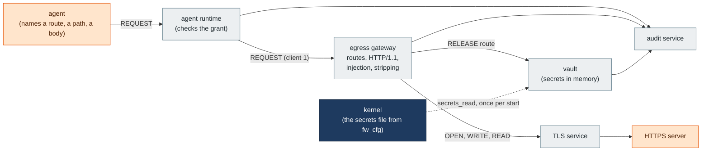

# The credential vault and the egress gateway

## 1. Status

- **Design:** **Accepted**: approved by the maintainer on 2026-11-23 (#280), with each open question decided as recommended (section 7). It follows [D-035](../project/decision-log.md#d-035-credential-vault-and-egress-gateway) (accepted 2026-11-23) and builds on the [TLS service](tls.md).
- **Implementation:** the vault is **implemented** (#281): the secrets file in the kernel and `secrets_read` (system call 34), `init` passing the file to the vault without reading it, the file's parser and the `vault` v1 codec (`pharos_proto::vault`, with audit client 5 and action `vault`, 25), routes in `pharos_services` with the rules the vault relies on, and the vault (`bin/vault`). The gateway is **implemented** (#282): `pharos_proto::http` (paths and patterns, the request head, the answer parser, stripping), the `gateway` v1 codec (`pharos_proto::gateway`, audit client 6 and action `https`, 26), every route rule in `pharos_services::check_routes`, the gateway's decisions in `pharos_programs::gateway` (host-tested) and the gateway (`bin/gateway`), the runtime's `REQUEST` and the `https` grant and manifest key, RSA PKCS#1 v1.5 and PSS and ECDSA P-384 in `pharos-tls`, and `cargo xtask run --secrets`. Neither runs in any table at boot yet, and the gateway and `REQUEST` are tested on the host only until the `vault` test kernel (#284). *As built* notes below. The fuzz tests are **implemented** (#283; [testing.md](../development/testing.md)). **Planned:** the `vault` test kernel (#284); `--tls-roots`, once a table that boots runs the gateway (open question 3).

## 2. Context

M6.2 must let an agent use a service that needs a credential without the agent ever holding it. D-035 decided the parts:
- the host delivers the secrets at each boot through `fw_cfg`, and nothing is written to Pharos's disk;
- a vault process holds them in memory and releases one per checked request, to the gateway only;
- an egress gateway builds every HTTP request from a compiled **route**, injects the secret, and strips it from the answer;
- RSA and P-384 verification join the TLS provider.

It left the interfaces, the formats, and the tests to this design.

Facts this design relies on:

- **IPC messages are at most 256 bytes**, and bulk data moves through one shared buffer per client, attached once with `ATTACH` (D-016 item 7), as the TLS service does.
- **The kernel reads `fw_cfg` files at boot** with port I/O only (`fw_cfg_file` in `arch/x86_64.rs`), as it does for the device key (D-047) and the boot check (D-049). The host names the file on QEMU's command line by path, so the value never appears in a process list.
- **Services get their tables from `pharos_services`**, chosen by `init`'s argument, and `init` sends a TLS client's destinations with `ALLOW` (tls.md).
- **The agent runtime checks every agent request** against the agent's policy entry and budgets, and records it before acting (`NO_AUDIT` otherwise; agents.md). `SEND_TO` is the model for a request that leaves the machine.
- **The host is trusted** until M8.2 (threat model): it already holds the device key, the clock, and the randomness.

## 3. Design

### Overview



An agent never names a host, a header, or a secret. It names a route it was granted, a path the route's pattern allows, and a body. The secret exists in the vault, briefly in the gateway while it writes the request, and in the TLS service's plaintext. It never reaches the runtime, an agent, a model, the store, or the audit trail.

### Components

| Component | Holds | Never holds |
| --- | --- | --- |
| Kernel | The secrets file as read from `fw_cfg`, for the boot | Any parse of it |
| Vault (new) | The parsed secrets; the route table; `SEND` on `audit` (client 5) | A network, TLS, or store capability; any client but the gateway |
| Gateway (new) | The route table; `SEND` on the vault and on the TLS service (as a TLS client); `SEND` on `audit` (client 6) | The secrets file; a store capability; sockets |
| Agent runtime | Each agent's `https` grants (route names) | Any capability on the vault |
| TLS service | As in M6.1; the gateway is one more client | Anything new |

### The secrets file

- **One `fw_cfg` file, `opt/org.pharos/secrets`,** given by the host to each machine `cargo xtask` starts when `--secrets <file>` is passed, and by the user guide's QEMU command otherwise.
- **Text, one secret a line:** `<name> <value>`, a single space between them, each line ending in `\n`.
  - The name is 1 to 32 bytes of `a`–`z`, `0`–`9`, `-`, `_`.
  - The value is 1 to 1,024 bytes of visible ASCII (0x21–0x7E), so it can never break a header line.
  - At most 16 secrets and 4 KiB in all. A name given twice is refused.
  - Any fault refuses the whole file, and the vault reports it by line number, never by content.
- **In the kernel:** read at boot into a 4 KiB kernel buffer, as the device key is. No file is the same as an empty one. The kernel never parses it.
  - It gives `init` a `Secrets` capability with `READ | GRANT`, as it gives `init` `Key(AuditAnchor)` for `audit`. `init` never reads it and passes it to the vault alone.
  - A new system call, `secrets_read(cap, buf)`, copies the file into the caller's buffer. It needs `READ`.
  - The kernel keeps its copy for the boot, so a restarted vault reads it again. Only a process holding the capability can, and `init` grants it to the vault alone.
- **Rotation:** replace the host's file and restart the machine. No rebuild. A route whose secret is missing answers `NO_SECRET`.
- *As built (#281):* `init` finds the capability after the two keys by asking only its size (a length of 0, which needs no buffer), so it never holds the secrets; a file over 4 KiB is ignored with a line on the serial console, and the vault then has none. The kernel zeroes its temporary copy after each `secrets_read`.

### Routes

A route is a compiled entry in `pharos_services`, in the table `init` runs, beside the TLS destinations:

| Field | Example | Rule |
| --- | --- | --- |
| `name` | `issues` | 1 to 32 bytes, as an agent name; what agents' grants and the audit trail name |
| `dest` | `0` | An index into the gateway's TLS destinations; the host and the certificate's name come from there |
| `method` | `POST` | One of `GET`, `POST`, `PUT`, `PATCH`, `DELETE` |
| `path` | `/repos/*/issues` | Literal segments and `*`; at most 128 bytes |
| `query` | `false` | Whether a query may follow the path |
| `secret` | `github-token` | A name in the secrets file, or none |
| `header` | `Authorization`, `Bearer ` | Where the secret goes: one header name and a fixed prefix |
| `headers` | `Accept: application/json` | Fixed headers, at most 4 |
| `max_body`, `max_answer` | 4 KiB, 32 KiB | Each at most 60 KiB; `max_body` 0 for `GET` and `DELETE` |
| `clients` | `[1]` | The gateway's clients that may use it |

Both the vault and the gateway link the table. The vault uses it to check that a route names a secret, and the gateway uses it for everything else. `cargo xtask` refuses a table whose route names a header the gateway writes (`Host`, `Content-Length`, `Connection`, `Accept-Encoding`, `Transfer-Encoding`) or puts the secret's header among the fixed ones.

### Paths

- A path is 1 to 256 bytes and starts with `/`. Its segments are 1 or more bytes of RFC 3986's unreserved characters (`A`–`Z`, `a`–`z`, `0`–`9`, `-`, `.`, `_`, `~`).
- Refused:
  - `.` and `..` segments;
  - empty segments (`//` or a trailing `/` the pattern does not have);
  - `%`, so nothing is decoded and nothing can be double-decoded;
  - `#`;
  - any other byte.
- A query (`?` and what follows) is allowed only on a route with `query`. It is 1 to 256 bytes of unreserved characters, `=`, and `&`, and the gateway does not parse it further.
- **Matching:** the path and the pattern have the same number of segments. Each literal segment is equal, and each `*` matches exactly one segment. There is no prefix matching.

### The vault and `vault` v1

- **Started by `init`** after `audit`, with: the console, `RECEIVE` on its endpoint, the report endpoint, the `Secrets` capability, and `audit` as client 5.
  - It reads and parses the file at start. A faulty file leaves it running with no secrets, so every `RELEASE` answers `NO_SECRET` and the console says which line failed.
- **Its only client is the gateway** (badge 1). `RELEASE` is `[1, 1, route:u8]`. The vault checks that the route exists and names a secret it holds, then writes `prefix ‖ value` into the gateway's attached buffer. The answer is `[status, 0, len:u16]`: `OK`, `NO_SECRET`, `NOT_FOUND` (no such route), or `NO_AUDIT`.
- **Every release and refusal is recorded** before it is answered: action `vault release`, the route's and the secret's names, and the outcome. No value is ever written.
- `INFO` and `ATTACH` as D-019. There is no operation that lists secrets or returns one by name.
- *As built (#281):* the gateway's buffer is at most 4 KiB; a release that would not fit is `NO_BUFFER`, recorded like the other refusals. The records are events (action `vault`, 25), outcome `ok` or `refused`, with the detail `release <route> secret <name>`, and ` status <n>` on a refusal; a route that does not exist is named by its number. The vault gets its table's number as its argument and reads that table's routes (`pharos_services::routes`).

### The gateway and `gateway` v1

- **Started by `init`** after the vault and the TLS service, with: the console, `RECEIVE` on its endpoint, the report endpoint, `SEND` on the vault, `SEND` on the TLS service as a TLS client with the destinations its routes use, and `audit` as client 6.
- **Its clients** are the agent runtime (client 1) and, in test tables, test programs. Each attaches a buffer of up to 64 KiB.
- **Operations:**

  | Op | Request | Reply |
  | --- | --- | --- |
  | 0xF1 `ATTACH` (common, a `send`) | buffer size (at most 64 KiB), with the `Memory` capability | none |
  | 1 `REQUEST` | `[1, 1, route:u8, path_len:u16, body_len:u32]`; the path, then the body, at offset 0 of the buffer | `[status, 0, http:u16, type_len:u8, answer_len:u32, stripped:u8]`, deferred (30 s); the content type, then the answer, at offset 0 |
  | 0xF0 `INFO` (common) | `[1, 0xF0]` | `[status, 1, 1, 7, "gateway"]` |

  Statuses: the common ones (D-019; `NO_ACCESS` for a route not listed for the client, `INVALID` for a path the pattern refuses or a body over `max_body`), and new ones:
  - 40 `NO_SECRET`;
  - 41 `TLS` with the TLS service's status and reason;
  - 42 `ANSWER` with a reason: 1 malformed, 2 over `max_answer`, 3 encoded (`Content-Encoding` other than `identity`), 4 a 1xx status, 5 cut short;
  - 43 `NO_AUDIT`;
  - 44 `TIMEOUT`.

  A non-2xx HTTP status is not an error: it reaches the client as `http`.
- *As built (#282):*
  - `REQUEST` names its route by name (`[1, 1, name length, name, path_len:u16, body_len:u32]`), not by number: the runtime does not know which table `init` runs, so it cannot number routes. The gateway finds the route's number for the vault.
  - There is no common `INVALID`: a path the pattern refuses is `BAD_REQUEST`, a body over `max_body` `TOO_LARGE`, a route the table lacks `NOT_FOUND`, a buffer too small `NO_BUFFER`. Each refusal is recorded (an event, outcome `refused`) before it is answered, or the answer is `NO_AUDIT`.
  - The reply is always `[status, detail, http:u16, type_len:u8, answer_len:u32, stripped:u8]`: on `TLS`, `detail` is the TLS service's status and `http` its reason; on `ANSWER`, `detail` is the reason.
  - The statuses are 40 `NO_SECRET`, 41 `TLS`, 42 `ANSWER`, 43 `NO_AUDIT`, and 44 `TIMEOUT`, as above.
  - One request at a time: a second client waits in the endpoint's queue for up to the first's 30 s.
- **A request, in order:**
  1. check the client may use the route, and the path and the body;
  2. record the intent;
  3. `RELEASE` from the vault;
  4. `OPEN` the route's destination;
  5. write the request;
  6. erase the secret from the gateway's memory;
  7. read the answer until the server closes;
  8. parse and strip it;
  9. record the outcome;
  10. answer.

  Any failure ends the request at that step, closes the connection, erases the secret, and records the outcome with its status.

  *As built (#282):* stripping needs the value, which step 6 erased. So, after step 8 has parsed the answer with no secret in the gateway's memory, the gateway asks the vault for it once more, strips, and erases it again: each request is two releases in the vault's trail. The answer is written to the client's buffer only once the outcome is recorded.
- **The request** is written by the gateway alone:

  ```text
  <method> <path>[?<query>] HTTP/1.1\r\n
  Host: <the destination's server name>\r\n
  <fixed headers>\r\n
  <secret header>: <prefix><value>\r\n
  Content-Length: <body length>\r\n        (only if the method takes a body)
  Accept-Encoding: identity\r\n
  Connection: close\r\n
  \r\n
  <body>
  ```

- **The answer** is parsed by the gateway's own HTTP/1.1 code (safe Rust, `pharos_proto::http`):
  - **Status line:** `HTTP/1.1` or `HTTP/1.0`, a three-digit status, and a reason that is not interpreted.
  - **Headers:** at most 8 KiB and 64 of them, names as RFC 9110 tokens, no obsolete line folding. A bare `\n` or a `\r` without `\n` is malformed.
  - **The headers that count:** `Content-Type` (at most 64 bytes, passed on); `Content-Length` or `Transfer-Encoding: chunked`, but not both, and no other transfer coding; `Content-Encoding`.
  - **No length:** the body runs to the server's `close_notify`. A connection that ends without one is reason 5.
  - **Stripping:** after the body is decoded, every occurrence of `prefix ‖ value` and of `value` alone is replaced by `[secret]`, and `stripped` counts them. The content type is checked the same way, and a type that contains the value is dropped. Only the status, the content type, and the body reach the client; no other header does.
- **Erasing:** the gateway overwrites the released bytes with zeros as soon as the request is written, and passes the buffer through `core::hint::black_box` so the writes are not optimized away. That is best effort, since user programs have no `unsafe` for a volatile write. A compromised gateway could keep a copy: see section 4.

### The agent runtime: `REQUEST` and the `https` grant

- **Policy entries gain `https`:** route names the agent may use. Manifests can narrow it (`https = issues`) but never widen it, as with `net`.
- **A new runtime operation, `REQUEST`** (agents v1), works like `SEND_TO`:
  - the agent puts the route's name, the path, and the body in its buffer;
  - the runtime checks the grant and the agent's network budget (bytes each way count against it), records the request (agent, task, route) or answers `NO_AUDIT`, and copies the path and the body into its own buffer at the gateway;
  - it copies the answer back into the agent's buffer;
  - it holds the agent's call for at most 35 s.
- The runtime can't tell its agents apart at the gateway: all of them are client 1. The gateway's per-client check is a second line, and the runtime's per-agent check is the one that decides between agents (as D-012 item 10 has for UDP).
- **No model tool yet:** a `request` tool for model-written calls (tools.md) is open question 1.
- *As built (#282):* `REQUEST` is agents operation 34: `[route name, path_len:u16, body_len:u32]`, the path and the body at the start of the agent's buffer; the reply is the gateway's, and the content type then the answer are copied to the start of the agent's buffer. The gateway is the runtime's handle 13, optional (without it every `REQUEST` is `INTERNAL`), with a 64 KiB buffer. The request's bytes are checked against the network budget before it is sent; the answer's are charged after it arrives (never refused, so the next request is). The intent records the route as detail with the `https` permission; the outcome, the gateway's status. `https` is not askable (decided: grants only). The runtime serves one request at a time, so a `REQUEST` holds every agent for up to 35 s.

### Signatures and roots

- **`pharos-tls`'s provider gains** RSA PKCS#1 v1.5 and PSS with SHA-256, SHA-384, and SHA-512 for 2,048- to 4,096-bit keys (rsa 0.10), and ECDSA P-384 with SHA-384 (p384 0.14). Verification only, for certificates and for the server's `CertificateVerify`. The TLS service's client offers the matching signature schemes. Its key exchange and cipher suite are unchanged.
- **Roots:** `cargo xtask build --tls-roots <PEM file>` writes `system/tls/roots` from a file the builder chooses, still at most 16 roots and 16 KiB. The release image's roots are open question 3.
- *As built (#282):* the provider verifies RSA PKCS#1 v1.5 with SHA-256, -384, and -512 (certificates) and PSS with the same hashes, the salt the hash's length (TLS 1.3's `CertificateVerify`), for keys of 2,048 to 4,096 bits, and ECDSA P-384 with SHA-384. rustls offers the matching schemes from the provider. A smaller or larger RSA key fails verification. `--tls-roots` is **planned**: `cargo xtask build` builds only the kernel, and no table that boots runs the gateway yet.

### Audit

| Record | By | Contents |
| --- | --- | --- |
| The agent's request | runtime (client 3) | agent, task, route |
| Intent | gateway (client 6) | client, route, method, path (the query's length only), the body's length and SHA-256 |
| Refusal | gateway | client, the route's name as asked, the status (#282, as built) |
| Release | vault (client 5) | route, secret's name, outcome |
| Connection | TLS service (client 4) | as in M6.1 |
| Outcome | gateway | status, HTTP status, answer length, `stripped` |

*As built (#282):* the records are action `https` (26); the detail is at most 64 bytes, so the intent is `c<client> <route> <method> q<query length> b<body length> <the first 8 bytes of the body's SHA-256, hex> <path>`, the path last and cut to fit; the outcome is `status <s> [detail <d>] http <h> answer <n> stripped <k>`. With the second release, a request is seven or eight records.

That is six or seven records a request, which fills the trail faster than UDP does. #275's rate limit covers it, and its design should count these.

### Budgets

- The vault: 64 KiB pages (16 secrets of at most 1 KiB, and its buffer).
- The gateway: one request at a time per client, 2 clients, 2 requests in all. It uses the TLS service's 2 connections for a client, one at a time, plus 2 × 64 KiB of buffers and 64 KiB for an answer in parsing: 512 KiB.
- Timeouts: the route's whole request is 30 s, within which the TLS service's own handshake (10 s) and idle (60 s, shortened to the remaining time) apply; the runtime's `REQUEST` gives up at 35 s.

## 4. Security

- **The new trust boundary is the gateway's answer parser.** It reads what an untrusted server sends, in the process that briefly holds a secret. The mitigations:
  - own, small, safe-Rust parsing, fuzzed (#283);
  - no compressed answers;
  - limits on every field;
  - the secret erased before the answer is read.

  A fault in the parser reaches the gateway's routes, its TLS destinations, and the one secret it released for that request.
- **A compromised gateway** can ask the vault for the secret of each of its routes and send it to the destinations those routes name. It can't reach any other host (the TLS service opens only `init`'s list), the store, or an agent's memory. This is D-035's carried limit, and the reason routes name destinations narrowly.
- **A compromised vault** holds every secret but has no channel out: no network, TLS, or store capability, and the gateway is its only client.
- **A compromised agent or runtime** gets answers with the secret stripped, never a header, and only for routes it was granted. A server that echoes the secret back in an encoded form (base64, a hash, split across JSON escapes) defeats stripping. That's D-035's carried limit, and routes should name servers that don't echo credentials.
- **Request smuggling and header injection:** every header the agent influences is fixed by the route, the path allows no `\r`, `\n`, space, or `%`, secret values are visible ASCII, and `Content-Length` is the gateway's. An agent can't add a header, change the method, or reach another path.
- **The host** holds every secret in a file and could read each from memory. It is trusted until M8.2.
- **The threat model** gains a "Credential vault and egress gateway (M6.2)" section with these rows, each **planned** until its issue lands.

## 5. Testing

| Layer | Tests |
| --- | --- |
| Host, `pharos_proto` | The secrets file: every rule, refusals by line, a duplicate name, 16 and 17 secrets. Paths: each refusal, `*` matching one segment and never two, queries only where allowed. The answer parser: lengths, chunks, both lengths at once, a 1xx, encodings, oversize headers and bodies, a cut-short answer. Stripping: the value at the start, the end, across chunk boundaries, twice, and in the content type. The `vault` v1 and `gateway` v1 codecs |
| Host, `pharos_services` | Every route in every table: a destination that exists, a secret's header not among the fixed ones, no reserved header, limits within 60 KiB |
| Host, `pharos-tls` | Handshakes with rustls servers holding RSA 2,048 and 4,096 and P-384 certificates, signed by RSA and P-384 authorities; an RSA key under 2,048 bits refused |
| Host, fuzzing (D-020 pattern, #283) | With a fixed seed and count: the secrets file, paths against patterns, the answer parser with stripping (no secret may survive in what it returns), and the two codecs; none may panic |
| QEMU, `vault` (#284) | A host HTTPS server (open question 2) checks that the header arrived with the test secret. A test agent, through the runtime: a granted route succeeds; the server's echo route returns the header in its body and the agent finds only `[secret]` there; a route not granted, a path the pattern refuses, and a method not listed are each refused and audited. The agent scans its whole buffer, and the runner scans the exported audit trail and the console, for the test secret, which must not appear. A table whose secrets file lacks the route's secret answers `NO_SECRET` |
| Mutation (#284) | A throwaway branch where the gateway skips stripping must fail `vault` in CI |
| Matrix | `vault` in every cell |

## 6. Alternatives

- **The gateway holds the secrets** (no vault): one process fewer, but the process that parses servers' answers would hold every secret for its whole life. Rejected in D-035.
- **Routes as a file in the image** instead of compiled tables: no code change to add a route, but a new parser, and the image is already rebuilt for every table change today. D-035 chose compiled routes; revisit when the policy service (M6.6) loads policy at run time.
- **Agents name headers:** more flexible, and the source of header injection and of agents setting `Authorization` themselves. Rejected.
- **httparse** for answers: 78 `unsafe` sites on this boundary (D-035). Rejected.
- **A read-once secrets file in the kernel:** the kernel would forget the secrets after the first read, but then a restarted vault would have none. Rejected for the copy kept for the boot.

## 7. Open questions

1. **A model tool:** only the runtime operation `REQUEST` in M6.2 (recommended: the foreign-agent bridge, M6.3, and payload approval, M6.4, decide how tools and approval meet requests), or also a `request` tool for model-written calls now?
2. **The test server:** Python's standard `http.server` and `ssl` (recommended: no new dependency, Python already runs in `scripts/check.sh` and CI), or a Rust server in `xtask` on rustls with its default provider (C and assembly in a host tool)?
3. **The release image's roots:** still none (recommended until a release table has a real route), or a small curated set now?
4. **Asking the user:** grants only in M6.2, with no confirmation per request (recommended: M6.4 adds approval of the exact payload), or an `ask_https` list confirmed on the trusted console as `send` is?

**Decided (2026-11-23, #280):** 1. only the runtime operation `REQUEST` in M6.2, no model tool; 2. Python's standard `http.server` and `ssl` for the test server; 3. no roots in the release image; 4. grants only, no confirmation per request.

## Implementation issues

The vault, its system call, and the secrets file (#281); the gateway, routes, HTTP, and `REQUEST` (#282); RSA and P-384 in `pharos-tls` (#282); the fuzz tests (#283); the `vault` test kernel and its mutation (#284). The gate is #285.
