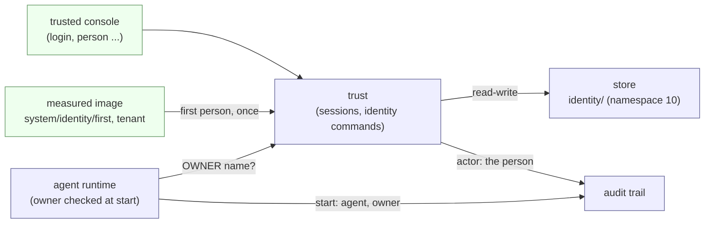

# Identity, owners, and actor resolution

## 1. Status

- **Design:** **Accepted**: approved by the maintainer on 2026-11-26 (#309), with each open question decided as recommended (section 7). It follows [D-038](../project/decision-log.md#d-038-identity-and-organization-model) (accepted 2026-11-25).
- **Implementation:** the records and the trusted-path commands are **implemented** (#310): `pharos_proto::identity` (the person file, fuzzed), `pharos_crypto::pbkdf2` (RFC 7914's vectors), store namespace 10, audit actions `login`, `logout`, and `identity` (29–31), the `trust` commands and sessions (`pharos_programs::identity`, host-tested), and `cargo xtask identity first`; the `trust` kernel logs in and checks a logout, a refused passphrase, and its delay. Owners are **implemented** (#311): `manifest::Entry::owner`, checked when the runtime compiles (`manifest::owned`), trust v1 `OWNER` (op 13), the attempt's `start` record, `list`, and `person remove`'s refusal; the `agents` kernel's `orphan` fails at its start. *As built* notes below. Actor resolution is **implemented** (#312): `cargo xtask store audit --resolve` (`xtask/src/resolve.rs`, host-tested), and the runner resolves every passing kernel's trail. The `identity` test kernel is **implemented** (#313): see Testing. **Planned:** the tenant's name; the CI run of a throwaway branch that grants by role (the gate, #314).

## 2. Context

M6.5 gives Pharos people, so that every audit record names a person or an agent, and every agent has a named human owner, without identity ever granting anything (D-018 item 2). D-038 decided the parts:
- identity records live in the store, change only by commands on the trusted console, and the measured image names the first administrator;
- the console knows who is typing by `login <name>` and a passphrase;
- every agent's compiled policy entry names its owner, a current person;
- roles and tenants are data only, with one tenant per runtime;
- actors resolve from the trail alone;
- a directory import is planned, not built.

What exists today (M6.3): audit actors are free names (an agent's, a service's, or `user` for the console); `trust` reads whole lines of at most 64 bytes from the console and echoes nothing (any echo is the host terminal's); store namespaces are badge numbers mapped to path prefixes in `pharos_proto::store::NAMESPACES`; names (`trust::valid_name`) are 1 to 32 bytes of letters, digits, `-`, and `_`.

## 3. Design

### Overview



### Records

- **One file per person**, `identity/people/<name>` in the new store namespace 10, `identity`. `trust` alone holds it, read-write; no one else does. The format is text, as manifests are, at most 1 KiB, one `key = value` per line, every key exactly once:

  ```text
  person = 1
  name = alice
  roles = approver,ops
  salt = <32 bytes, hex>
  iterations = 600000
  hash = <32 bytes, hex>
  ```

  `name` must equal the file's name. `roles` is up to 8 names, comma-separated, or empty. The parser (`pharos_proto::identity`) refuses unknown, repeated, and missing keys and never panics; it is fuzzed.
- **The tenant** is one name in the measured image, `system/identity/tenant`. `trust` shows it in `whoami` and in its ready record.
- **The first administrator** is a person file in the measured image, `system/identity/first`, in the same format. When `trust` starts and `identity/people/` is empty, it copies that file there and records `person add <name> from image`. After that the image's file is not read again; changing the first person's passphrase is a trusted-path command like any other.
- **`cargo xtask identity first <name>`** writes `system/identity/first` for a build: it reads the passphrase from the builder's terminal twice, without echo, and writes the salt and hash, never the passphrase. Test images use a fixed test passphrase, named like the test secret (`pharos_services::TEST_PASSPHRASE`), which no release image contains.
- *As built (#310, D-038 amended 2026-11-26):* **the host seeds the store, not the image.** One release image is shared by every install and must build to the same bytes, so it cannot hold a first person. `cargo xtask identity first <name> --store <store.img>` writes `identity/people/<name>` into the store disk before the first boot (refused if the store has people), with a salt from the host's `/dev/urandom` and `identity::ITERATIONS`; `trust` finds the person there, and copies nothing. A release `store.img` stays empty. Test and `cargo xtask run` stores get the test person `admin` (`pharos_services::TEST_PERSON`, `TEST_PASSPHRASE`) with 1,000 iterations, so logins stay quick under TCG; `person add` always uses 600,000. With no people in the store, `trust` says so at start, and only `stop all` works. The tenant file is not built yet.

### Passphrases

- **The hash** is PBKDF2 with HMAC-SHA-256 (RFC 8018), one 32-byte block, over `pharos_crypto::hmac`: no new dependency. 600,000 iterations (OWASP's 2023 figure for PBKDF2-HMAC-SHA256), stored in the record so a later change does not break old records. The implementation measures it in QEMU and in KVM; if one check takes over 2 s on the reference platform, the design is revisited, not the count quietly cut.
- **The salt** is 32 bytes: SHA-256 over the name, the wall clock, the uptime, and RDSEED where the CPU has it. A salt needs to be unique, not secret, and `trust` holds no random device (the TLS service holds the only virtio-rng). The hash is compared in constant time (`pharos_crypto::equal`).
- **A passphrase** is one console line, 8 to 64 bytes. It is held only while it is hashed, then zeroed, and appears in no record and no console line. Pharos echoes nothing; whether the host terminal echoes is the host's (trusted until M8.2), and `cargo xtask run` turns its terminal's echo off while `trust` asks for one.
- *As built (#310):* after a passphrase line `trust` zeroes the line, the line buffer (`Lines::wipe`), and its receive bytes; the virtio-console driver clears each received chunk from its DMA page as it copies it (`Mapped::take_bytes`). `cargo xtask run`'s console is a pair of FIFOs (`echo ... > trust.in`), not a terminal, so there is no echo to turn off; `identity first` turns its own terminal's echo off (`stty -echo`).

### Sessions

- **With no one logged in,** the console answers only `login <name>`, `stop all` (the emergency stop, D-018's trusted path, never locked), and `help`. Every other command says `log in first`.
- *As built (#310, amended by the maintainer on 2026-11-26):* **every stop works logged out**, not only `stop all`: `stop <agent>`, `stop group <group>`, and `stop service <service>` too, recorded with actor `console`. They only take away, never grant, as the emergency stop does. Found by the `aifail` kernel: with memory used up by a runaway service, the store cannot map a restarted `trust`'s buffer, so no one can log in, and the runaway must still be stoppable from the console. Starting, restarting, approving, revoking, applying, rotating, and the people commands still need a login. With the store not answering, `login` says so (`login: the identity store did not answer`), not `login refused`.
- *As built (#310):* refusals from a no-one state are recorded with actor `console`; a `login` typed while the wait runs is answered `login: wait <n> s` and not checked; `person remove` of the logged-in person ends the session. The owner rule for `person remove`: see Owners.
- **`login <name>`** prints `passphrase:`; the next line is the passphrase. A match starts a session and records `login <name>`. A wrong passphrase, or a name with no record (answered the same way, so names cannot be probed), records `login refused <name>` and makes the next attempt wait: 1 s, doubling to at most 60 s, reset by a success. The wait keeps `stop all` working.
- **`logout`**, and 15 minutes without a typed line, end the session and record `logout <name>` or `logout <name> idle`.
- **`whoami`** prints the person, their roles, and the tenant.
- **One session at a time:** the console is one device. A second `login` ends the first session.

### Commands

All need a session, are typed on the trusted console, and record the person who typed them as the actor:

| Command | Effect | Record |
| --- | --- | --- |
| `people` | each person and their roles | — |
| `person add <name> [<role>,...]` | asks for the new person's passphrase twice; writes the file | `person add <name> roles <roles>` |
| `person roles <name> <role>,...` | replaces the roles | `person roles <name> <roles>` |
| `person passphrase <name>` | asks for a new passphrase twice | `person passphrase <name>` |
| `person remove <name>` | removes the file; refused for the last person, or for the owner of an agent in any policy entry | `person remove <name>` |

Who may type them is whoever is logged in, as for every other trusted-path command today: restricting them by role would make the role an authority (D-018), so any restriction is D-037's or D-039's to decide.

### Owners

- **`manifest::Entry` gains `owner`,** a person's name. The host rules (`pharos_services`) refuse a compiled entry without one. The manifest cannot name or change it: a manifest only asks.
- **At each attempt's start** the runtime asks `trust` whether the owner is a current person: a new trust v1 operation, `OWNER <name>`, answered `OK` or `NOT_FOUND`, on the channel the runtime already holds (`SEND` on `trust`, badge `RUNTIME`). The runtime gains no capability: it already holds `spawn`'s 12 in the full tables. If the answer is `NOT_FOUND`, or `trust` does not answer within 5 s (it may be hashing a passphrase, at most 2 s), the attempt does not start: the task fails `no owner <name>` or `owner not checked`, recorded. It fails closed. The attempt's start record names the owner (`start ... owner <name>`).
- **`list`** shows each agent's owner.
- **Removing a person** who owns an agent in the compiled policy is refused (above), so a current entry never names a removed person through the console; a rebuild that names a person who does not exist is caught at start.
- *As built (#311):* the tables are in the runtime (`user/programs/src/bin/agents.rs`), so the check is a compile-time assert there (`manifest::owned`: every owner a valid name), not a `pharos_services` rule; the test agents are owned by the seeded test person, `admin`, and the runner seeds it into every test store. `OWNER` `[version, op, name length, name]` is the one trust v1 request answered: the runtime `call`s it on its reply endpoint, and `trust` answers one byte, `OK`, `NOT_FOUND`, or `BUSY` when it cannot read its people (the runtime fails the attempt `owner not checked`). `REGISTER` gains the owner (after the attempt), so `list` shows `<agent> running; owner <name>`. The start record is action `start` from client 3, actor the agent, detail `owner <name>` (outcome `ok`) or the refusal (outcome `refused`); it is written before the agent is spawned, best effort like other events. `trust` refuses `person remove` of every name the runtime asked about: the runtime asks of each owner in its table when it starts, and again at each attempt. **Limit:** a restarted `trust` knows no owners until the runtime's next attempt starts, so in between it would remove one; the attempt's check still refuses that agent then.

### Actor resolution

- **Records name their actors as today, with people in place of `user`:** `trust` writes the logged-in person's name. With no session, a `stop all` is recorded with actor `console` (the emergency stop is never locked), and a refused login with actor `console`.
- **An actor resolves by the record's audit client and its name,** so a person and an agent with the same name are never confused:
  - client `TRUST` (2): a person, bound by the trail's `person add` records (or `console`, above);
  - client `RUNTIME` (3): an agent, bound to its owner by its attempt's start record;
  - client `INIT` (1): a service in `init`'s table, or `init`;
  - the services that write their own records (clients 0, 4, 5, 6): that service.
- **Records before M6.5** name `user`, which resolves to "the console, before identities".
- **`cargo xtask store audit --resolve`** prints each record with its resolved principal (`person alice`, `agent fetcher (owner alice)`, `service tls`) and fails on one that does not resolve. It needs only the trail: the resolution is the trail's own records, so an auditor's copy resolves the same way.
- *As built (#312):* the first administrator is seeded by the host (#310), so no `person add` names them: a client-2 actor is a person from the first record that shows one, a passed `login <name>` or a `person add <name>`; nothing is typed as a person without a login before it, so every person's record follows one in the trail (a rotation that frees boot 1 also frees its logins, and boot 2's records follow boot 2's). `console` is "the console, no one logged in". A runtime record with task 0 is a control client's request (`submit`), before any attempt: "the runtime, for a control client (agent <name>)". An agent's records resolve through its last `start` record with `owner <name>`; a refused `start` resolves as itself (`agent orphan (refused: no owner nobody)`). Clients 0, 4, 5, and 6 are the audit service, `tls`, the vault, and the gateway; a client-1 actor is `init` or a service named in one of `init`'s tables (`pharos_services::table`). The runner resolves the whole trail of every passing test kernel (`resolve_check`).

### Roles and tenants

- **Roles are data only.** They are shown (`people`, `whoami`) and recorded, and no code reads a role to decide anything. A later decision may use a role to narrow what a person may do (who may approve a marked action, D-037), never to grant a capability.
- **One tenant per runtime,** named in the image. Several tenants are M6.10's.

### Audit

New actions (`pharos_proto::audit::action`): `login`, `logout`, and `identity` (the `person` commands), each with the details above. No passphrase, salt, or hash appears in any record. The runtime's start record gains the owner.

### Budgets

- `trust` gains `SEND` on the store for namespace 10 (read-write), `READ` on the root filesystem for `system/identity/first` and `system/identity/tenant` (as the runtime reads manifests), and a 4 KiB store buffer (one person file): two capabilities, to 7 of `spawn`'s 12. Its page limit grows by the buffer and the PBKDF2 state, a few pages.
- *As built (#310):* with the store seeded by the host, `trust` needs no root filesystem capability: it gains only `SEND` on the store for namespace 10 (`IDENTITY_STORE`), its handle 6, to 6 of 12 (the `supervision` table, with no knowledge service, holds a capability with no rights at handle 5, so handle 6 stays the store's). Its page limit was 0 (it mapped nothing); it is now 32 pages (`TRUST_LIMIT`): the buffer and its heap.
- The runtime gains no capability (it holds `spawn`'s 12 in the full tables): owners are checked through `trust` (above).
- At most 64 people (a store `list` page), checked at `person add`.

## 4. Security

- **The trust boundary moves inside `trust`:** it now holds the passphrase hashes and decides who is logged in. A fault in it reaches the console and the identity records, as a fault there already reaches every approval. It gains no capability but namespace 10 and read access to the image.
- **What a person is trusted with:** everything the console could do before. Identity adds attribution and, through M6.4, distinct approvers; it adds no authority.
- **Guessing:** an online guess costs 1 s doubling to 60 s and a record each; an offline guess needs the store's file, which the host holds (trusted) and which costs 600,000 HMAC iterations per try.
- **The host** sees the console's bytes, the passphrase among them, and the store: trusted until M8.2, as for every other secret (D-047, D-035).
- **Not closed:** a person sharing their passphrase; one person typing as two with two passphrases (M6.4 will count approvers, not hands); revocation of an exported trail's names (the trail is append-only).
- **The threat model** gains an "Identity and owners (M6.5)" section with these rows, each **planned** until its issue lands.

## 5. Testing

| Layer | Tests |
| --- | --- |
| Host, `pharos-proto` | The person file's parser and every refusal; PBKDF2 against RFC 7914's PBKDF2-HMAC-SHA256 test vectors; the new audit actions; trust v1 `OWNER` round trips and refusals |
| Host, fuzzing (D-020 pattern) | Person files, with a fixed seed and count; none may panic |
| Host, `pharos-services` | Every compiled policy entry names an owner; namespace 10 held only by `trust` |
| Host, `xtask` | `identity first` writes a record the parser accepts and no passphrase; `store audit --resolve` on a trail with each kind of actor, and one that does not resolve |
| QEMU, `identity` (**implemented**, #313) | Logged out, only `login`, the stops, and `help` answer; a wrong passphrase is refused, recorded, and slowed; the image's first person logs in, adds a person with a role, and that role gains nothing (the agents' grants are unchanged); an agent whose owner does not exist is refused at start and recorded, and one whose owner was checked starts; `logout` and the idle timeout end the session; the runner resolves every record of the trail and finds no passphrase in it or on the console |
| CI | A throwaway branch where the runtime grants a permission to an agent whose owner has a role must fail `identity` (D-018's rule, M6.5's validation). *Locally (#313):* with the runtime granting `asker` model 2, `identity` fails; the CI run on a pushed branch is the gate's (#314) |
- *As built (#313):* `trust`'s argument is its idle limit in seconds (0, as `init` passes, for 15 minutes); the kernel passes 3. The session's idle time now counts from `trust`'s answer to a line, not the line itself, so a command that hashes a passphrase (5 s under TCG at 600,000 iterations) does not use it up. The role check: the runner gives `admin`, which owns `asker`, the role `ops`, then stops a waiting `asker` from the console; only then does the client start the last `asker`, which must find model 2 and its files refused; the runner checks from the trail that the role came first and the attempt got no grant. Typed logged in, `audit rotate` reaches the audit service (the rotation kernel's case logged out).

## 6. Alternatives

- **Records only in the image** (D-038 option a): a person leaving needs a release.
- **A name with no secret** (option d): M6.4's two approvers would be two names typed by one person.
- **The runtime reading `identity/` from the store** (a `stat` per start): simpler, but it needs a thirteenth capability, past `spawn`'s 12, which the runtime already holds in the full tables.

## 7. Open questions

**Decided (2026-11-26, #309):** 1. 600,000 iterations, revisited if one check takes over 2 s on the reference platform; 2. a 15-minute idle timeout; 3. the first person's passphrase set at build time by `cargo xtask identity first`, not at the first login; 4. removing a person who owns an agent in the compiled policy is refused.

1. **Iterations:** 600,000, or fewer for faster logins.
2. **Idle timeout:** 15 minutes, or shorter.
3. **The first person's passphrase** set at build time, or at the first login on a fresh system (simpler, but whoever reaches the console first chooses it).
4. **Removing a person who owns an agent** refused, or allowed, with the agent then refused at its next start.

## Implementation issues

#310 (records and commands), #311 (owners), #312 (actor resolution), #313 (the `identity` kernel), #314 (the gate).
