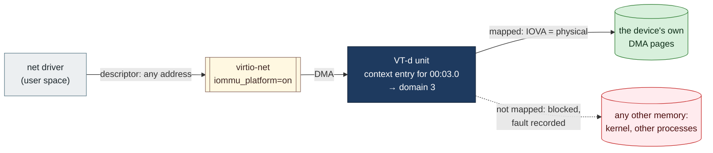

# DMA isolation: a VT-d driver for QEMU's `intel-iommu`

## 1. Status

- **Design:** **Draft**, for the maintainer's approval (#239). It follows [D-044](../project/decision-log.md#d-044-reference-platform-and-the-limits-required-on-a-real-host) item 3 (accepted 2026-11-15) and [D-008](../project/decision-log.md) (user-space drivers, the IOMMU left open).
- **Implementation:** **planned**; nothing here exists yet. Facts marked *(to verify)* are checked by the first prototype before the code is reviewed.

## 2. Context

A driver reaches its device through capabilities: registers, interrupts, and DMA buffers from `dma_alloc` ([drivers.md](drivers.md)). Nothing stops it from writing any physical address into a descriptor, and the device then reads or writes that address: a compromised driver controls all guest memory, kernel included. The threat model carries this as a limit (no IOMMU); on a KVM host it is real. The network service is the realistic attacker, since it parses packets from untrusted peers.

What the kernel already does that this builds on (`kernel/src/device.rs`):

- one `DeviceHandle` per granted PCI function, at most one driver at a time;
- every DMA buffer allocated by the kernel (`dma_alloc`, at most 64 pages per device), recorded with its owner;
- bus mastering off before a device's buffers are freed (on the handle's drop and when the owning process ends), on again at the next `dma_alloc`.

What it lacks: any ACPI parsing (PCI configuration goes through ports `0xcf8`/`0xcfc`), and any way to make the device itself unable to reach memory it was not given.

Facts about the platform (QEMU 8.2 on the development host):

- `-device intel-iommu` needs `q35`, which every image already uses. Defaults: legacy (not scalable) mode, 39-bit guest addresses (3-level second-level tables), `caching-mode=off`, interrupt remapping `auto`.
- A virtio-pci device bypasses the IOMMU unless it is created with `iommu_platform=on`, and then its driver must accept `VIRTIO_F_ACCESS_PLATFORM` (feature bit 33). Today's drivers negotiate only `VERSION_1` (bit 32). *(To verify: whether QEMU refuses `FEATURES_OK` when the driver does not accept bit 33.)*
- VT-d does not translate writes to the interrupt range `0xfee0_0000`–`0xfeef_ffff`; they are MSIs.

## 3. Design

### Overview

- **One domain per granted device.** Each `DeviceHandle` gets its own second-level page table. It maps exactly that device's DMA buffers, at I/O virtual address = physical address (identity), so drivers and descriptors do not change. Everything else is unmapped, so the device's access to it faults.
- **Blocked by default.** Translation is turned on at boot, before any driver runs, with every context entry not present: a device no driver holds can reach nothing.
- **Order of operations,** the invariant the review checks:
  - `grant`: attach the device (context entry → its empty domain, context-cache invalidation) **before** bus mastering goes on;
  - `dma_alloc`: map the new pages (and flush the write buffer if `CAP.RWBF`) **before** returning them to the driver;
  - process end or handle drop: bus mastering off, unmap the pages, **invalidate the IOTLB for the domain and wait for it to finish**, and only then free the frames;
  - handle drop: detach the context entry (invalidate) before the function can be granted again.

### Pieces

| Piece | Where | `unsafe` | Does |
| --- | --- | --- | --- |
| Limine RSDP request | `kernel/src/limine.rs` (already an `unsafe` module) | a new request static, as the others | gives the RSDP's physical address, read before bootloader memory is reclaimed (#223's `BootMemory`) |
| ACPI walk and DMAR parser | `kernel/src/acpi.rs`, safe | none | RSDP → XSDT → `DMAR`; each table's length and checksum checked; returns the DRHD units (register base, `INCLUDE_PCI_ALL`, device scopes). Reads physical memory through the existing safe direct-map reads. Host-tested and fuzzed |
| VT-d registers | `kernel/src/arch/x86_64/iommu.rs` (hardware layer, already allowed) | volatile MMIO reads and writes of the unit's 4 KiB register page | `CAP`, `ECAP`, `GCMD`/`GSTS`, `RTADDR`, `CCMD`, `IOTLB` (at `ECAP.IRO`), fault status and recording registers |
| Tables | `kernel/src/iommu.rs`, safe | none (frames written through `mm::raw`'s existing safe slices) | root table (256 buses), context tables, second-level tables (3 levels for 39-bit, 4 for 48-bit by `CAP.SAGAW`), domain IDs (`CAP.ND`) |
| Hooks | `kernel/src/device.rs` | none | attach on `grant`, map on `add_dma`, unmap and invalidate before `free`, detach on drop |
| Driver feature | `user/programs/src/virtio.rs` | none | accept `VIRTIO_F_ACCESS_PLATFORM` when the device offers it |
| QEMU settings | `xtask` | none | `-device intel-iommu,intremap=off` and `iommu_platform=on` on every virtio device, in every boot and test kernel |

- **Invalidation is register-based** (`CCMD`, `IOTLB`), not the invalidation queue: one unit, a few invalidations per `dma_alloc` or driver exit, so a queue's speed is not needed and its code is avoided. *(To verify: QEMU's register-based invalidation in legacy mode.)*
- **Faults** are read from the fault-recording registers and printed (`iommu: device 00:03.0 blocked write to 0x…`), counted per device, and cleared. The fault interrupt is not used at first: the kernel polls the status on each device stop and in the test kernel.
- **No IOMMU found:** the kernel refuses to hand a device to a driver, so the boot fails with `no IOMMU (DMAR) found; drivers cannot be isolated (D-044)`. Fail closed, as the CPU check (#237). `cargo xtask` adds the IOMMU everywhere, so every test still boots. (Open question 1.)

## 4. Security

- **Closes:** a driver programming its device to read or write memory it was not given (kernel, other processes, freed frames). The device faults instead.
- **Trusted code added:** the VT-d register layer (volatile MMIO in the hardware layer), the table builder, and the ACPI and DMAR parsers, which read firmware tables (trusted, as the firmware is) but are still checked for length and checksum and fuzzed.
- **Not closed (stated in the threat model):**
  - **MSI injection:** without interrupt remapping, a device can write to `0xfee0_0000` and raise any vector on the CPU. That is a denial of service (spurious interrupts), not memory access. Interrupt remapping needs QEMU's `kernel-irqchip=split` under KVM and a remapping table; carried to M8.1 with bare-metal VT-d. (Open question 2.)
  - **Peer-to-peer DMA** between devices behind the same bridge, which QEMU's root bus does not have.
  - **The IOMMU's own correctness** in QEMU: trusted, as the VMM is.
- **ATS and device-IOTLB** stay off (`device-iotlb=off`), so a device cannot cache translations the kernel has removed.

## 5. Testing

- **Host:** the DMAR and ACPI parsers (every field, wrong lengths and checksums, scopes), fuzzed like the other parsers; the table builder (entries, levels, identity mapping, unmapping); context-entry and page-entry encodings against the VT-d specification.
- **A new test kernel, `iommu`:** translation on; a driver test program asks for a DMA buffer, then writes a virtio-blk read descriptor pointing at a kernel canary frame. Passes only if the canary is unchanged, a fault is recorded for that device and address, and an ordinary read into its own buffer still works. A second case: after the driver ends, the old buffer's frames are unmapped (a stale descriptor faults).
- **Mutation:** identity-mapping all memory in the domain, or leaving translation off, must fail `iommu` (a throwaway branch in CI, as M5.2's validation asks).
- **Everything else with the IOMMU on:** the full suite, the matrix (the `kvm` cell included), and S1. S1 loads a 676 MB model through virtio-blk, and every DMA is now translated by QEMU, so its timings are measured against today's (risk below).

## 6. Alternatives

- **`virtio-iommu`:** needs a virtqueue in the kernel (every virtio driver is in user space today), and no bare-metal machine has it. Rejected in D-044.
- **Keep drivers in the trusted base:** the network service stays one bug from kernel memory. Rejected in D-044.
- **Map DMA pages at an I/O virtual address chosen by the kernel** instead of identity: hides physical addresses from drivers, but every driver must translate, and drivers already see physical addresses today. Identity first; revisit if physical addresses become a secret.
- **The invalidation queue:** faster for many invalidations; not needed at today's rate.

## 7. Open questions

1. **No IOMMU:** refuse to boot (recommended, fail closed), or boot with the limit printed and stated?
2. **Interrupt remapping:** carry MSI injection to M8.1 as stated (recommended for M5.2's size), or add it now?
3. **S1's cost:** if translated DMA slows model loading beyond what S1 allows, is a larger mapping granularity (2 MiB pages for large buffers) acceptable, or a longer S1 limit?

## Implementation issues (to file once approved)

1. ACPI walk and DMAR parser, host-tested (`acpi.rs`, the Limine RSDP request).
2. VT-d registers and tables, translation on at boot with nothing attached (`arch/x86_64/iommu.rs`, `iommu.rs`).
3. Device hooks and `VIRTIO_F_ACCESS_PLATFORM`, with `xtask` adding the IOMMU everywhere.
4. The `iommu` test kernel, its mutation, and the threat model's rows; the matrix and S1 measured.
