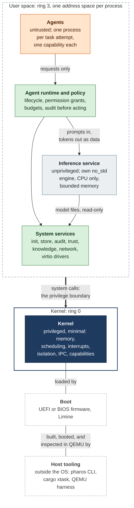
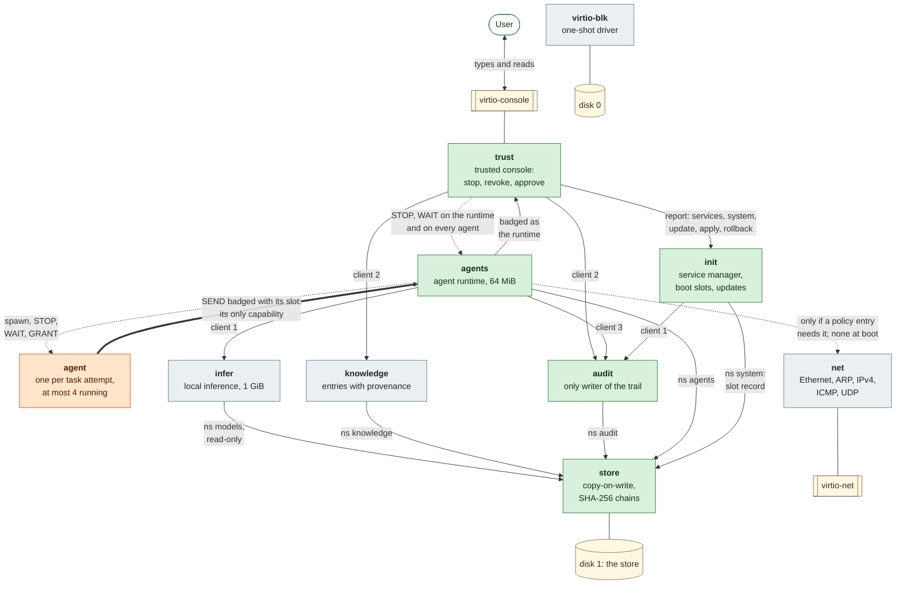
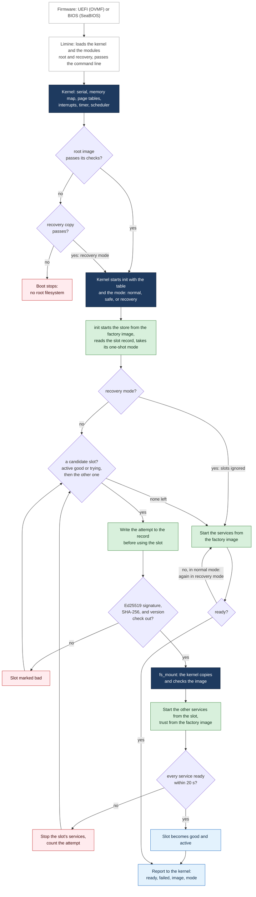
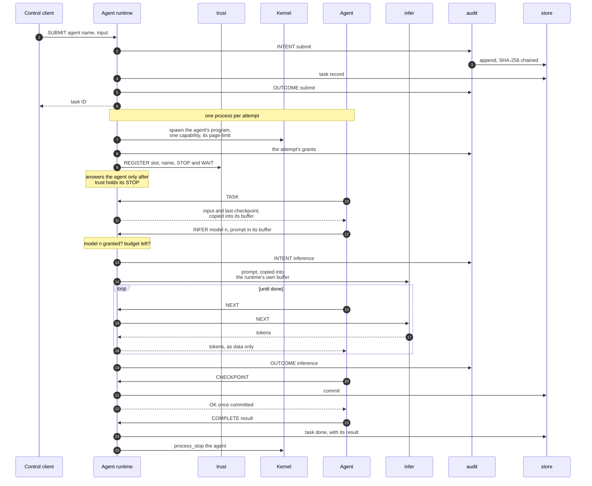
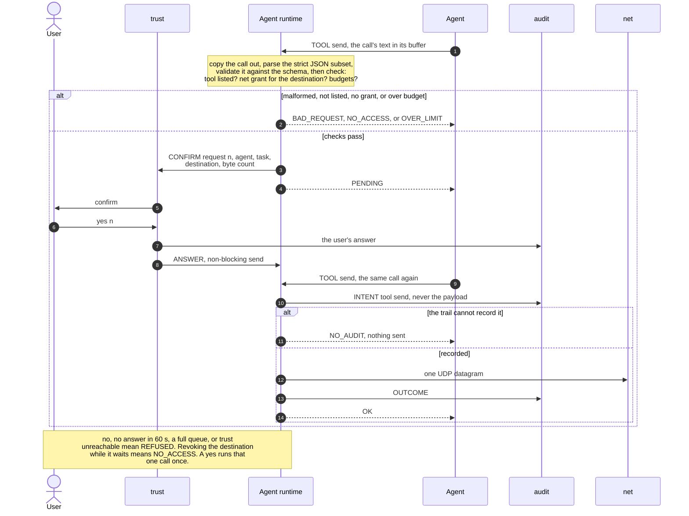
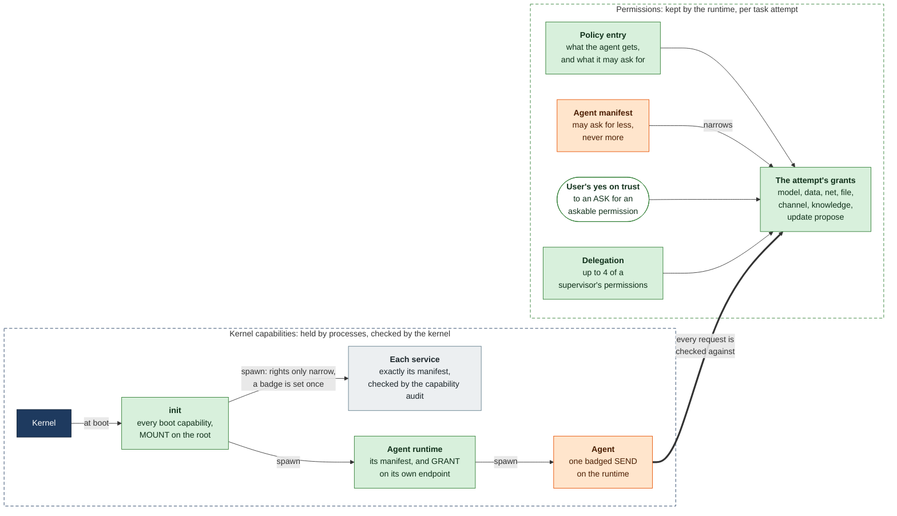
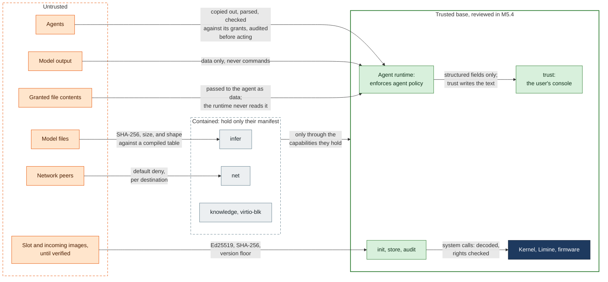

# How Pharos works

This page explains how the parts of Pharos fit together: what each process holds, how the system boots, how an agent's request is checked, and where the trust boundaries are. It is the place to start. The other documents in this directory hold the detailed designs, and this page links to them; where they and this page differ, they are right and this page needs fixing.

**Status:** every diagram shows what is **implemented** on `main`, on one CPU in QEMU, unless a part is labelled **planned**. Each one is drawn from the code it names (`pharos_services::tables::BOOT` for the capability map, `init`'s `boot_image` for the boot), so a change to that code updates the diagram in the same change (AGENTS.md section 8).

Reading order for a new contributor: this page, then [system calls and IPC](syscalls-ipc.md) (the kernel interface everything uses), [services](services.md) (`init` and the service table), [agents](agents.md) and [capabilities](capabilities.md) (the runtime and its permissions), and the [threat model](../security/threat-model.md).

## Contents

1. [Layers](#1-layers)
2. [Processes and the capabilities they hold](#2-processes-and-the-capabilities-they-hold)
3. [Boot](#3-boot)
4. [An agent task, end to end](#4-an-agent-task-end-to-end)
5. [A sensitive tool call](#5-a-sensitive-tool-call)
6. [Where authority comes from, and how it is taken away](#6-where-authority-comes-from-and-how-it-is-taken-away)
7. [Trust zones](#7-trust-zones)

Colours are the same in every diagram:

| Colour | Means |
| --- | --- |
| Dark blue | The kernel: the only privileged code |
| Green | The trusted base reviewed in M5.4 ([review](../security/review-m5.4-trusted-base.md)) |
| Grey | Services outside the trusted base: they hold only their manifest |
| Orange | Untrusted: agents and everything a model writes |
| Dashed arrow | A process capability (spawn, `STOP`, `WAIT`), or a capability that only some service tables give, as its label says |

## 1. Layers

Each layer reaches the one below only through IPC endpoints it holds as capabilities, and all of user space reaches the kernel only through system calls.

Every arrow inside user space is IPC through an endpoint capability.

Details: [architecture overview](../project/architecture.md), decision [D-004](../project/decision-log.md#d-004-kernel-architecture-and-privilege-boundaries).

## 2. Processes and the capabilities they hold

This is the boot table (`pharos_services::tables::BOOT`). Every arrow is a kernel capability: `SEND` on another process's endpoint (labelled with its badge or store namespace), a device, or a process capability. A process can reach nothing it holds no arrow to. The capability audit (D-027) checks every running service against this table.

Not drawn, to keep the picture readable: every service except `virtio-blk` also holds the debug console and `SEND` on `init`'s report endpoint (ready, health, and events); `init` holds every boot capability and starts every process.

`ns` is a store namespace: each client's badge names the one namespace it reaches, and whether it may write it. Green is the trusted base, grey a service outside it, orange untrusted.

What the picture shows:

- **An agent holds one capability for its whole life**, `SEND` on the runtime, badged with its slot. Everything it does is a runtime request, which the runtime checks against that slot's grants ([agents](agents.md#processes-and-what-each-holds)).
- **`trust` can stop the runtime and every agent without the runtime's help.** `init` gives it `STOP` on the runtime, and the runtime registers each agent with `trust` before answering any of its requests (D-018).
- **Only `audit` writes the audit trail** and only `knowledge` writes namespace `knowledge`; every other writer goes through them.
- **`infer` reads models and nothing else.** It reaches no agent, no network, and no file but `models`, read-only.
- **At boot the runtime's policy table is empty,** so no agent runs and the runtime gets no network, files, knowledge, or update capability. Test tables give it those to test them (dashed line).

Details: [services](services.md), [agents](agents.md), [storage](storage.md), [networking](networking.md), [inference](inference.md), [knowledge](knowledge.md).

## 3. Boot

The kernel mounts the factory image and starts `init`. `init` then picks the root image the other services run from: a signed A/B slot, or the factory image. The storage service and `trust` always come from the factory image, so a bad slot can break neither the code that falls back nor the trusted path. Every fallback happens in place, without a reboot.

- **Safe mode** (Limine entry, or `trust`'s `safe` for the next boot) starts every service but the agent runtime; **recovery** is safe mode on the factory image with the slots ignored.
- **An update** goes through the same path: `trust`'s `apply` makes `init` write the image to the slot that is not active and try it in place; if it is not ready, that slot becomes bad and the previous one runs again.
- The kernel waits up to 75 s for `init`'s report, enough for two slots and the factory image.

Details: [boot](boot.md), and [recovery and updates](boot.md#8-recovery-and-updates-m43-d-028).

## 4. An agent task, end to end

A task comes from a control client (the test kernels' tables list one; the boot table lists none). The runtime starts one agent process per attempt. Every consequential step is recorded in the audit trail **before** it is done, and refused with `NO_AUDIT` if it cannot be recorded.

- **A crash or a hang** (no request for `progress_ms`) ends the attempt; the runtime starts a new one with the last checkpoint, up to the entry's attempts, then fails the task.
- **The runtime never interprets model output.** Tokens reach the agent as data; anything a model makes the agent ask for is one more request through the same checks.
- **Budgets** (CPU, pages, tokens, datagrams, requests, file bytes) are checked on each request, per attempt and per group ([resources](resources.md)).

Details: [agents](agents.md#lifecycle-98), [the runtime's interface](agents.md#the-runtimes-interface-agents-version-1), [durable tasks](agents.md#durable-tasks-99).

## 5. A sensitive tool call

`send` is the one sensitive tool: each call needs the user's yes on the trusted console. The runtime never waits; the agent polls with the same call. `trust` writes the prompt from structured fields, so no agent or model text reaches the user's screen.

The network leg exists only in test tables today: the boot table gives the runtime no network capability (section 2).

Details: [tools](tools.md), [approval on the trusted path](capabilities.md#approval-on-the-trusted-path-106).

## 6. Where authority comes from, and how it is taken away

Pharos has two kinds of authority. **Kernel capabilities** are held by processes and checked by the kernel on every system call. **Permissions** are grants the runtime keeps for each task attempt and checks on every request; an agent never holds them as capabilities.

Authority is taken away in five ways, none of which needs the agent's help:

| How | Who | What it reaches |
| --- | --- | --- |
| `revoke <agent> <permission>` | the user, on `trust` | that permission, from every task of the agent that has not ended: a running attempt at once, a waiting one at its next start; inference sessions and network flows opened with it end, and a waiting confirmation ends with `NO_ACCESS` |
| Expiry | the runtime | a grant past its deadline, checked on every use, as if revoked |
| `stop <agent>`, `stop group <group>` | the user, on `trust` | `process_stop` on the agent's processes, done by `trust` itself, without the runtime |
| `stop all` | the user, on `trust` | the runtime, and with it every agent; `init` restarts nothing that was stopped until the next boot |
| Kernel `revoke` of memory or a device | the holder of the original capability (for example `init`, taking a device from a driver) | every mapping made through it or a capability derived from it, in every process, before `revoke` returns; the pages become private zeroed memory |

- **Rights only narrow** as a capability is passed on, and a badge, once set, cannot be changed, so a service can tell its clients apart and no client can pose as another.
- **Nothing is remembered across tasks:** an attempt's grants are rebuilt from the policy entry, the manifest, and the task's own approvals.
- **Stopping a process stops every process it started,** depth first, so no work outlives its supervisor.

Details: [capabilities](capabilities.md), [coordination](coordination.md#delegation-135), [system calls and IPC](syscalls-ipc.md), decision [D-012](../project/decision-log.md#d-012-agent-sandboxing-tool-permissions-and-network-isolation).

## 7. Trust zones

Who must be correct for the system's guarantees to hold, and what is checked where untrusted data crosses into trusted code.

- **The agent runtime is in the trusted base for agent policy,** since it holds and checks every agent's permissions, and it is also tested as compromised: the `compromised` test kernel runs a hostile program under the runtime's exact manifest and checks that it can do nothing beyond it (86 probes, all refused), and the same for `infer` (83).
- **A model's output is untrusted input everywhere.** A prompt injection can make an agent ask for anything, but only through requests the runtime checks against permissions the user or a policy granted.

Details: [threat model](../security/threat-model.md), [M5.4 review](../security/review-m5.4-trusted-base.md), [the hostile services](services.md#ai-services-m46-d-031).
