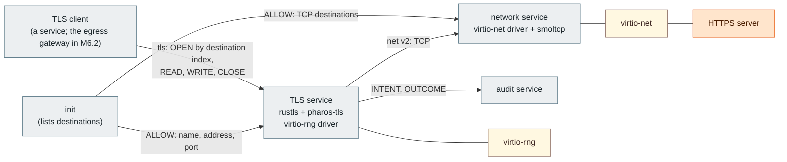

# TCP and TLS: the TLS service and its trust boundary

## 1. Status

- **Design:** **Accepted**: approved by the maintainer on 2026-11-21 (#269), with each open question decided as recommended (section 7). It follows [D-034](../project/decision-log.md#d-034-tcp-and-tls-stack) (accepted 2026-11-21) and amends [networking.md](networking.md) (D-015) and the [audit service](capabilities.md#the-audit-service-107).
- **Implementation:** TCP is **implemented** (#270): smoltcp 0.14 in the network service and `net` v2, as "The network service" below describes, tested by the `network` test kernel against the host's TCP echo server ([networking.md](networking.md#smoltcp-270-d-034)). The TLS client is **implemented** (#271): the crate `pharos-tls` (the provider, the HMAC-DRBG, the root file, the configuration, and a sans-I/O session, host-tested against a rustls server), `clock_real` (system call 33), the `tls` v1 codec (`pharos_proto::tls`, with audit client 4 and action `tls`, 24), and the TLS service with its virtio-rng driver (`bin/tls`), in the `network` test kernel's table only, where it has no audit trail and is checked to refuse before sending anything. Three changes to the design, found while building it, are marked *As built (#271)* below. The fuzz tests are **implemented** (#272): 200,000 frames into smoltcp, 100,000 server flights, 100,000 mutated certificate chains, root files, and the `net` v2 and `tls` codecs, in the host tests CI runs on every push ([testing.md](../development/testing.md)). **Planned** (M6.1): the `tls` test kernel (#273), the first to complete a handshake in QEMU.

## 2. Context

M6.1 must let an allowed action reach an HTTPS service, with TCP and TLS as user-space services and agents holding no sockets (D-012, D-015). D-034 chose the parts: smoltcp 0.14 in the network service, rustls 0.23 (TLS 1.3, client only) in its own process, rustls-webpki against a pinned root set, and Pharos's own crypto provider (`pharos-tls`). It left three mechanisms to this design: the time source, the randomness source, and the interfaces.

Facts this design relies on:

- **IPC messages are at most 256 bytes**, and a `call` carries one capability, its reply. Bulk data moves through one shared buffer per client, attached once with `ATTACH` (as the storage service does since #77; `mem_share`, D-016 item 7).
- **`spawn` passes one 64-bit argument** and up to 12 capabilities; `uptime()` gives microseconds since boot.
- **Limine 12 has a date-at-boot request** returning Unix seconds from the firmware's clock (Limine's protocol documentation, v12.x; both halves of the request ID, `0x502746e184c088aa` and `0xfbc5ec83e6327893`, are in the pinned 12.9.4 `BOOTX64.EFI`). Under QEMU the firmware clock is the emulated RTC, which follows the host's clock unless `-rtc base=` says otherwise.
- **QEMU's default CPU model, `qemu64`, has no RDRAND or RDSEED**, and the default matrix cells use it. `virtio-rng-pci` reads the host's `/dev/urandom` by default.
- **The audit service** takes records from badged clients (1 `init`, 2 `trust`, 3 the runtime) and refuses with `UNWRITABLE` when it cannot store them.
- **The host is trusted** until M8.2 (threat model): it already holds the device key, so the time and randomness it gives add no new trust.

## 3. Design

### Overview

### Components

| Component | Where | `unsafe` |
| --- | --- | --- |
| TCP, IP, ARP, ICMP, UDP | smoltcp 0.14 in the network service (`user/programs/src/bin/net.rs`), replacing `pharos_programs::net`'s IP layer | none in Pharos code |
| Interface `net` v2 | `pharos_proto::net`: v1 unchanged, TCP operations added | none |
| Crypto provider | new crate `crates/pharos-tls` (`no_std`, host-tested): rustls's provider traits on RustCrypto and `pharos-crypto` | none |
| Random generator | `pharos-tls`: HMAC-DRBG (SHA-256, NIST SP 800-90A) on `pharos-crypto` | none |
| TLS service | new program `user/programs/src/bin/tls.rs`: rustls's unbuffered client, the virtio-rng driver, the `tls` interface | none |
| Interface `tls` v1 | `pharos_proto::tls` | none |
| Boot time | the kernel's Limine request and a new system call (below) | Limine module only (existing pattern) |
| Host side of the test | `cargo xtask`: a certificate authority and certificates made with `openssl`, and `openssl s_server` | none (host code) |

### The network service: smoltcp and `net` v2

- **smoltcp takes over the IP layer.** The virtio-net driver stays as it is; frames go to a smoltcp `Interface` through a `Device` over the driver's buffers. Ethernet, ARP, IPv4, ICMP echo, and UDP move to smoltcp; the static slirp addresses stay (`10.0.2.15/24`, gateway `10.0.2.2`). Features: `medium-ethernet`, `proto-ipv4`, `socket-tcp`, `socket-udp`, `socket-icmp`.
- **v1 is unchanged** for UDP clients (`send`, `recv`, `ping`, `stats`, `ALLOW`, `POLL`): the service answers versions 1 to 2, so `network`, `agents_net`, and the runtime keep working unchanged.
- **v2 adds TCP**, for clients `init` lists TCP destinations for:

  | Op | Request | Reply |
  | --- | --- | --- |
  | 0xF1 `ATTACH` (common, a `send`) | buffer size (at most 64 KiB), with the `Memory` capability | none |
  | 7 `TCP_OPEN` | `[2, 7, dst_port:u16, dst_ip:[u8;4]]` | `[status, conn:u8]`, deferred until connected or refused (5 s) |
  | 8 `TCP_WRITE` | `[2, 8, conn, offset:u32, len:u32]` (a range of the buffer) | `[status, 0, written:u32]` |
  | 9 `TCP_READ` | `[2, 9, conn, offset:u32, max:u32]` | `[status, 0, read:u32]`, deferred until data, end of stream, or reset; 0 bytes is the end |
  | 10 `TCP_CLOSE` | `[2, 10, conn]` | `[status]` |
  | 11 `ALLOW_TCP` | as `ALLOW`, only without a badge (`init`) | `[status]` |

  New statuses: 34 `REFUSED` (reset or no answer), 35 `CLOSED` (the connection is gone). The local port is the service's choice; a client cannot pick it. Limits: 4 connections per client, 16 in all, each with 8 KiB receive and send windows; a connection idle for 60 s is closed.
- *As built (#271):* two operations that never defer, for the TLS service: **12 `TCP_CONNECT`** (as `TCP_OPEN`, answered at once with the connection, which connects in the background; writes take 0 bytes until it is connected) and **13 `TCP_POLL`** (as `TCP_READ`, answered at once, `NOT_FOUND` when nothing has arrived or it is still connecting, `REFUSED` once if the connection failed). IPC is synchronous and a server answers with `try_send`, which reaches only a caller waiting at that moment, so a single-threaded service cannot wait in a deferred call while it serves its own clients and `init`'s health checks; it polls each open connection every 10 ms instead.
- **Destinations:** a client opens TCP only to an address and port `ALLOW_TCP` listed for it, sent by `init` each time the service reports ready, as `ALLOW` is today (#109).
- **Fuzzing:** frames reach the receive path through smoltcp in host tests (the D-020 pattern, below).

### The TLS service and `tls` v1

- **Started by `init`** after the network and audit services, with: its endpoint; `SEND` on the network service with TCP destinations; `SEND` on `audit` (client 4); the virtio-rng device; the root set (below); and a page limit. No store capability and no device but virtio-rng. *As built (#271),* in handle order: the console, the virtio-rng device, `RECEIVE` on its endpoint, the report endpoint, `READ` on the root filesystem, the network service (badged port 40443), and the audit service as client 4 (without it every `OPEN` is `NO_AUDIT`).
- **A client's capability** is `SEND` on the TLS service's endpoint, badged by `init` with a client number (1–8). In M6.1 only services and test programs get one; the agent runtime gets none, so no agent reaches HTTPS before the egress gateway (M6.2).
- **Destinations come from `init`, never from the client.** `ALLOW` (badge 0 only) sets, for one client, destination *i*: an address, a port, and the server name used both for SNI and for the certificate check (at most 64 bytes, a DNS name; no IP-address names). A client opens a connection by **index**, so it can neither name another host nor make the service check a certificate against a name of its choosing. There is no DNS.
- **Operations** (each request starts with the version, 1):

  | Op | Request | Reply |
  | --- | --- | --- |
  | 0xF1 `ATTACH` (common, a `send`) | buffer size (at most 64 KiB), with the `Memory` capability | none |
  | 1 `OPEN` | `[1, 1, destination:u8]` | `[status, conn:u8, reason:u8]`, deferred until the handshake ends (10 s) |
  | 2 `WRITE` | `[1, 2, conn, offset:u32, len:u32]` | `[status, 0, written:u32]` |
  | 3 `READ` | `[1, 3, conn, offset:u32, max:u32]` | `[status, 0, read:u32]`, deferred; 0 bytes is the server's `close_notify` |
  | 4 `CLOSE` | `[1, 4, conn]` | `[status]` (sends `close_notify`) |
  | 5 `ALLOW` | `[1, 5, client, destination, ip:[u8;4], port:u16, len, name…]` (badge 0 only) | `[status]` |
  | 0xF0 `INFO` (common) | `[1, 0xF0]` | `[status, 1, 1, 3, "tls"]` |

  Statuses: the common ones (D-019; `OVER_LIMIT` for a client's third connection or the service's fifth), and 32 `HANDSHAKE` with a reason: 1 unknown issuer, 2 expired or not yet valid, 3 name mismatch, 4 another certificate error, 5 protocol error or alert, 6 TCP refused, 7 the handshake's 10 s ran out (added in #271); 33 `NO_CLOCK`; 34 `NO_RANDOM`; 35 `CLOSED` (the server reset or a record failed to decrypt); 36 `NO_AUDIT` (the intent could not be stored, added in #271). The codec is `pharos_proto::tls` (#271): a server name is 1 to 64 bytes of DNS labels with at least one letter, so an IP address is refused; clients are 1 to 8 and destinations 0 to 7. Limits: 2 connections per client, 4 in all, each budgeted at 64 KiB for rustls's buffers (measured in #271).
- **What rustls is given:** TLS 1.3 only; the suite `TLS13_AES_128_GCM_SHA256`; key exchange X25519, then secp256r1; signatures ECDSA P-256 with SHA-256 and Ed25519; no client certificate; no session tickets or resumption, so nothing is kept between connections; no early data. A server that offers none of these fails with reason 5.
- **Failure is closed and final:** a connection that fails a check is never retried with weaker settings, and its data is never released to the client. A failed record (`bad_record_mac`) ends the connection with `CLOSED`.

### The pinned root set

- **One file in the image, `system/tls/roots`:** DER certificates, each preceded by its length (u16), at most 16 roots and 16 KiB. The image is measured at boot, so the signed audit head covers the roots ([release-integrity.md](release-integrity.md)).
- `init` reads it from the root filesystem and passes it to the TLS service in a shared buffer at start; a missing or malformed file leaves the service with no roots, so every `OPEN` fails with reason 1. *As built (#271):* the service reads the file itself, with `READ` on the root filesystem. A buffer from `init` would take a `send`, which has no timeout, so `init` could hang on a TLS service that is not receiving. The image is public and measured, so reading the rest of it gives the service nothing secret.
- **The release image ships no roots in M6.1;** the test images carry the test authority's certificate, made by `cargo xtask` for each build. The roots for real endpoints come with M6.2's egress gateway, which knows its endpoints.
- No system or bundled roots (no `webpki-roots`), no revocation checks (D-034's carried limit), and only the `serverAuth` purpose is accepted.

### Time

- **The kernel asks Limine for the date at boot** and keeps it. A new system call, `clock_real` (no capability; it gives no authority and is as coarse as one second), returns that date plus `uptime()` in seconds.
- **The floor:** a date before the build's `SOURCE_DATE_EPOCH` (built into the kernel) is treated as no date, so a reset RTC (1970 or 2000) cannot make an expired certificate look valid. With no date, `clock_real` returns `NO_CLOCK`, and every `OPEN` fails with `NO_CLOCK`.
- **The clock's owner is the host**, as is everything QEMU emulates. A host that sets `-rtc base=` in the past can make an expired certificate pass; the host is trusted until M8.2.

### Randomness

- **The TLS service drives a `virtio-rng-pci` device** (behind the IOMMU, as every virtio device) and seeds an HMAC-DRBG with 48 bytes from it, mixed with 32 bytes of RDSEED when CPUID reports it. It reseeds after 1 MiB of output or 10,000 requests, whichever comes first. *As built (#271):* RDSEED is read through `pharos_user::entropy::rdseed64`, the one new `unsafe` (inline assembly in `pharos-user`'s `syscall.rs`, the module AGENTS.md section 5 allows it in); it reseeds from the device before every handshake, so neither limit is reached in practice; the generator still refuses past them.
- **No seed, no handshake:** if the device is absent or gives fewer bytes than asked within 1 s, `OPEN` fails with `NO_RANDOM`. A virtio-rng device that returns data cannot be told apart from a good one, which is why RDSEED is mixed in where the CPU has it.
- `cargo xtask` adds `-object rng-random,id=rng0,filename=/dev/urandom -device virtio-rng-pci,rng=rng0,iommu_platform=on,disable-legacy=on` to every QEMU run, and the user guide's command gains it.

### Audit

- **The TLS service is audit client 4.** Before connecting it writes an `INTENT` (client, destination index and name, action `tls open`), and it connects only once that is stored; if the audit service cannot write, `OPEN` fails with `NO_AUDIT`. It writes the `OUTCOME` (ok, or `HANDSHAKE` with its reason, `NO_CLOCK`, `NO_RANDOM`) and, on close, the bytes each way. Content is never recorded.

### Budgets

- The TLS service's page limit covers 4 connections, the 8 attached buffers, and the roots: 4 MiB. The network service's grows by its 16 TCP sockets: 1 MiB more.
- Every deferred reply has a timeout (TCP connect 5 s, handshake 10 s, idle 60 s), so a silent server cannot hold a client's call forever; this removes the network service's "no timeouts" limit for TCP, not for `ping`.

## 4. Security

- **The new trust boundary is the TLS service.** It holds no store capability, no agent's grants, and only the virtio-rng device. A fault in rustls or `pharos-tls` reaches only the connections it carries and the destinations `init` listed, never the network device, other services, or an agent.
- **What it is trusted with:** the plaintext of its connections, and the check that the server is who the destination's name says. A bug in the check is the worst case: a client would talk to a server it did not mean to. The mitigations: webpki, rustls's name check, the name from `init` and never the client, the `tls` kernel's three refusals, and the throwaway branch that skips the name check (M6.1's validation).
- **The network service grows** by TCP, the largest parser it runs; it was already untrusted and fuzzed, and stays so. It never sees plaintext.
- **Peers are untrusted input:** every record, handshake message, and certificate is parsed by rustls and webpki (safe Rust, `forbid(unsafe_code)` in rustls), fuzzed on the host.
- **Not closed:** revocation; a host that lies about the time or the randomness (trusted until M8.2); traffic analysis (sizes and timing are visible to the host and the network); one cipher suite and no RSA, so most public servers are unreachable until M6.2 (D-034).
- **The threat model** gains a "TCP and TLS (M6.1)" section with these rows, each **planned** until its issue lands.

## 5. Testing

| Layer | Tests |
| --- | --- |
| Host, `pharos-tls` | The key schedule on `pharos-crypto` against RFC 8448's early, derived, and handshake secrets (its RSA signatures are outside the provider), X25519 against RFC 7748, and AES-128-GCM, secp256r1, ECDSA P-256, and Ed25519 through handshakes with rustls's ring provider (as built, #271: the glue is what Pharos adds; the crates carry their own vectors); the HMAC-DRBG against NIST's CAVP vectors; a handshake with a rustls server for each refusal (rustls with its default provider as a host-only test dependency: C and assembly on the host, never in an image; justified in #271 as AGENTS.md section 6 asks): unknown issuer, expired, not yet valid, wrong name, a suite or group not offered, a truncated record |
| Host, fuzzing (D-020 pattern, #272) | Stable-Rust tests with a fixed seed and count: 100,000 random and mutated server flights into the client through `pharos-tls`, 100,000 mutated certificates into the webpki check, 100,000 mutated frames into the network service's smoltcp receive path, and the `net` v2 and `tls` codecs; none may panic, and nothing accepted may break the rules. The count is the CI budget. *As built (#272):* 200,000 frames, with checksums not checked on receipt so mutations reach TCP; the client's random source repeats in the flight test, so one captured flight answers every ClientHello and mutations reach the encrypted handshake when they leave it intact; a mutated leaf must never pass the verifier; 20,000 root files besides; the crypto crates are built optimized in test builds so the budget runs in about 30 s |
| Host, `pharos_proto` | `net` v2 and `tls` round trips, every truncation, bad versions, names over 64 bytes, `ALLOW` without badge 0 |
| Host, `xtask` | The test authority, a good certificate, an expired one (`-not_after` in the past), and one for another name are made; `s_server` starts, serves, stops, and reports a taken port |
| QEMU, `network` and `agents_net` | Unchanged, on smoltcp |
| QEMU, `tls` (#273) | A test client opens destination 0 (`10.0.2.2:47443`, the good name), sends an HTTP request, and reads the reply from `s_server`; destinations 1–3 (expired, wrong name, unknown issuer) each fail with their reason; an index not listed is `NO_ACCESS`; the audit trail holds the intents and outcomes. A second table with no virtio-rng refuses with `NO_RANDOM` |
| Mutation (#273) | A throwaway branch that skips the name check must fail `tls` in CI |
| Matrix | `tls` in every cell, `kvm` included |

## 6. Alternatives

- **TLS inside the network service:** one process fewer, but a TLS fault would reach the network device and every client's traffic. Rejected.
- **TLS in each client:** every client would hold sockets and carry rustls. Rejected in D-034.
- **The name chosen by the client:** simpler for callers, but a client could then check a certificate against any name it likes. Rejected.
- **Time through `init`'s argument** instead of a system call: no kernel change beyond the Limine request, but every service that needs time would need it passed and refreshed by `init`. Open question 1.
- **A separate `rng` service:** a cleaner split, and the vault (M6.2) will need randomness too; one process more now for one consumer. Open question 2.
- **Limine's entropy request** as the seed: on `qemu64` it has no hardware source and falls back to a software generator. Not enough alone; usable as a third input.

## 7. Open questions

1. **Time:** a `clock_real` system call (recommended: one read-only value, any service can use it), or the boot date passed to the TLS service through `init`?
2. **Randomness:** the virtio-rng driver inside the TLS service (recommended for M6.1; moved to its own service when the vault needs it in M6.2), or a separate `rng` service now?
3. **The release image's roots:** ship none in M6.1 (recommended: no real endpoint is reachable before M6.2 anyway), or a small set now?

**Decided (2026-11-21, #269):** 1. the `clock_real` system call; 2. the virtio-rng driver in the TLS service, moved to its own service when the vault needs it (M6.2); 3. no roots in the release image in M6.1.

## Implementation issues

1. #270: smoltcp in the network service, `net` v2, the TCP limits and timeouts; `network` and `agents_net` unchanged.
2. #271: `pharos-tls` (provider, HMAC-DRBG), the TLS service, the virtio-rng driver, `clock_real` and the Limine date, the root file, audit client 4, `tls` v1.
3. #272: the fuzz tests above, run in CI with their counts.
4. #273: the `tls` test kernel, the host test authority and `s_server` in `cargo xtask`, the throwaway branch, and the threat model's rows.
