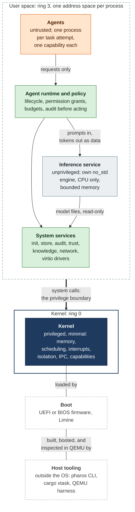
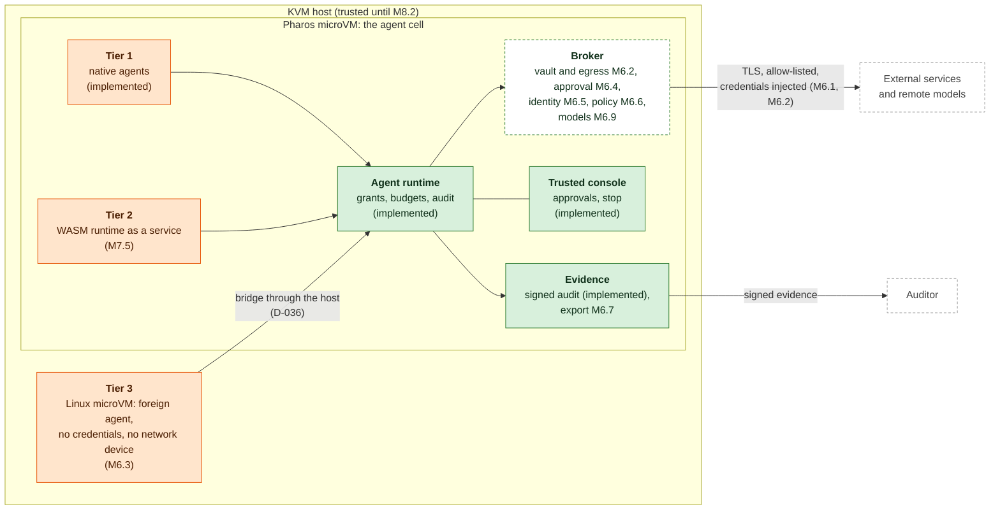

# Architecture

This document has three parts: what is **implemented** in v0.5.0, component by component; the implemented architecture (its layers, boundaries, and capability model); and the **planned** agent cell of [D-033](decision-log.md#d-033-repositioning-pharos-as-an-agent-cell-and-authority-broker-and-the-three-tiers): the broker and the three tiers, rewritten in M6.0 (#265). [How Pharos works](../architecture/overview.md) shows how the implemented parts interact; the [vision](vision.md) says why, and the [comparison](comparison.md) how it differs from the alternatives.

## Implemented architecture

Phases 1–5 are done (v0.5.0, the microVM release; [roadmap](implementation-roadmap.md)).

```text
Cargo workspace (stable Rust, edition 2024)
├── kernel             pharos-kernel for x86_64-unknown-none: the capability microkernel
├── crates/            no_std libraries shared by the kernel, user programs, and host tools:
│                      pharos-crypto, pharos-elf, pharos-fs, pharos-image, pharos-infer,
│                      pharos-proto, pharos-services, pharos-store
├── user/pharos-user   the user-space system-call library (its only unsafe module)
├── user/programs      init, the services, drivers, and test programs
├── tools/pharos-cli   binary `pharos` (host): read-only development CLI, std only
└── xtask              binary `xtask` (host): builds images, runs QEMU tests and the matrix
```

- **Platform:** a microVM on QEMU with KVM, the [reference platform](../development/reference-platform.md): virtio-pci devices only, each behind its own VT-d domain ([iommu.md](../architecture/iommu.md)); the kernel refuses to boot on a CPU affected by Meltdown or MDS, and `rdtsc` faults in user mode (D-044).
- **Kernel:** Limine boots it on UEFI and BIOS. It handles exceptions and local APIC timer interrupts, manages memory with its own page tables, schedules threads preemptively on one CPU in three classes, and runs user processes in ring 3, each in its own address space, with system calls, synchronous IPC that passes capabilities, and capabilities for memory, devices, interrupts, and processes ([architecture docs](../architecture/README.md)).
- **User space:** `init` starts and supervises the services from audited manifests: virtio-blk, virtio-net, and virtio-console drivers; storage (`store`, copy-on-write with a SHA-256-chained audit trail); networking (own stack, UDP and ICMP); `audit`; local inference (`infer`, own `no_std` engine, CPU only); `knowledge`; the agent runtime; and `trust`, the trusted console no agent can reach. Boot uses signed A/B root images with a factory fallback; the system runs until the VM is stopped (D-049).
- **Evidence:** a device key per VM from the host; the kernel measures what it boots; the audit trail's head is Ed25519-signed after every record and checked outside Pharos (`cargo xtask store audit`), and the trail is exported and rotated from the trusted console; Secure Boot with Pharos's keys; reproducible releases with signed `SHA256SUMS` ([release-integrity.md](../architecture/release-integrity.md), [user guide](../user/microvm.md)).
- **Agents:** untrusted processes holding only what the runtime grants: revocable permissions, default-deny networking per destination, budgets, two tools (`read_file`, and `send` confirmed by the user per call), channels and groups, every consequential action audited or refused.
- **Tests:** 81 QEMU test kernels, 11 boot checks, and host tests on every push; the release matrix (8 cells), repeat passes, a soak, and S1 end to end weekly ([testing.md](../development/testing.md)); written [release criteria](release-criteria.md).
- `unsafe` is forbidden in host crates. In the kernel it is allowed only in the hardware layer, the Limine module, and `mm::raw`; in user space only in `user/pharos-user/src/syscall.rs`; each block documented (AGENTS.md §5). Two third-party dependencies: `ed25519-compact` and `libm`.
- Runs only in QEMU (KVM, and TCG for tests), x86-64, one CPU. Agents are Tier 1 only: `no_std` Rust programs under the runtime.

## Architecture

### Layers

Implemented as drawn, on one CPU in a QEMU microVM. How the parts interact, process by process, is in [how Pharos works](../architecture/overview.md).



### Boundaries

| Boundary | Rule |
| --- | --- |
| Kernel ↔ user space | Only the kernel runs privileged. User space reaches it through a small, documented system-call interface. |
| Services ↔ agents | Agents reach services only through IPC endpoints granted to them as capabilities. |
| Inference ↔ everything privileged | Inference is an unprivileged service. Its output is data, never commands, until checked by policy. |
| Agent ↔ agent | No shared state by default; communication only through granted channels. |
| Host tooling ↔ OS | Host tools build, launch, and inspect the OS in QEMU; they are not part of the OS trust base. |
| Host ↔ Pharos | The KVM host is trusted on the reference platform: it runs the VM, holds the per-VM device key, and chooses the firmware (D-044, D-047). |

### Capability model

Agents start with no authority. The user or a policy grants specific capabilities (for example: read one directory, call one tool, reach one network host). Grants are logged, can be limited by time and resources, and can be revoked. The mechanism is decided: kernel-enforced capabilities, with policy in the agent runtime (D-012).

### Kernel style

The kernel style is decided (decision D-004, accepted 2026-10-27): a **capability-based microkernel**. The kernel keeps address spaces, threads and scheduling, IPC, capabilities, and interrupt delivery, while drivers, filesystems, networking, and AI services run in user space. Inside the kernel, `unsafe` code is confined to a small hardware layer. The decision, its IPC budget, the evidence that would reopen it, and the constraints it places on kernel code are in the [decision log](decision-log.md#d-004-kernel-architecture-and-privilege-boundaries).

## Planned: the agent cell (D-033)

Everything in this section is **planned, not implemented**. Each part names its milestone and its open decision record; the design is decided in that record, so what follows is the shape D-033 sets, not the design.

### The cell



### The broker

| Part | What it does | Milestone | Decision |
| --- | --- | --- | --- |
| TCP and TLS | user-space services, so an allowed action reaches an HTTPS service; agents never hold sockets | M6.1 | D-034 |
| Credential vault and egress gateway | secrets held as capabilities, put on requests at the boundary only when an allow-list permits the endpoint, method, and path; agents never see them | M6.2 | D-035 |
| Foreign-agent bridge | the channel from a Tier 3 guest to the runtime, and what the host must guarantee | M6.3 | D-036 |
| Payload approval | the human approves the full payload, not only its destination and size, routed by risk | M6.4 | D-037 |
| Identity and organization | principals, roles, tenants, and ownership, mapped onto the runtime's badges | M6.5 | D-038 |
| Runtime policy | a signed, versioned policy within the compiled ceilings | M6.6 | D-039 |
| Evidence | export of the signed trail an auditor can read, and its anchoring outside the system | M6.7, M6.8 | D-040 |
| Model broker | local or remote models reached only through Pharos, their output untrusted | M6.9 | D-041 |
| Scale | one runtime per tenant, more concurrent agents, the SMP decision | M6.10 | D-042 |

### Trusted base by tier

| Tier | Trusted base for the agent's limits |
| --- | --- |
| 1. Native (implemented) | the Pharos kernel, `init`, the agent runtime, `trust`, `audit`, `store`, and the host (which runs the VM and holds the device key) |
| 2. WASM (M7.5) | as Tier 1, plus the WASM runtime, itself an unprivileged service holding only what it is granted |
| 3. Foreign (M6.3) | as Tier 1 for every external action; for the guest's containment, the host kernel and hypervisor too, until Pharos is the hypervisor (M8.2) |

### Rules for the planned parts

- Nothing moves into the kernel. A change that seems to need it is an open question for review.
- Model output stays untrusted input (AGENTS.md §7), whichever model produced it.
- Each part names its test kernel or harness, and a throwaway branch that must fail CI; each that changes a trust boundary has a security review; each phase gate updates the [threat model](../security/threat-model.md).

## Keeping this document accurate

- Move an item from "planned" to "implemented" only when it exists and is tested.
- Detailed designs go in [docs/architecture/](../architecture/README.md), starting with [how Pharos works](../architecture/overview.md); this file stays a short overview.
