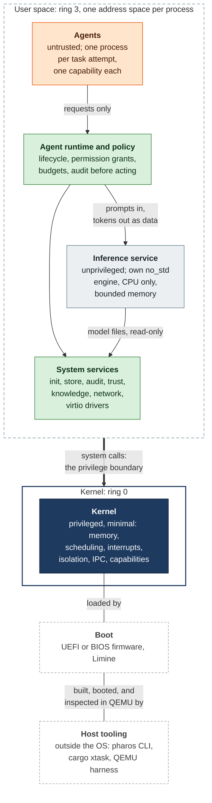

# Architecture

This document has two parts: what is **implemented** today, component by component, and the architecture: its layers, boundaries, and capability model. The architecture was proposed before Phase 2 and is now implemented; the decisions it names are accepted in the [decision log](decision-log.md). [How Pharos works](../architecture/overview.md) shows how the parts interact.

## Implemented architecture

Phases 1–4, M5.1, and M5.4 are done (v0.4.0; [roadmap](implementation-roadmap.md)). This overview is refreshed for facts only; M6.0 rewrites the document if D-033 is accepted.

```text
Cargo workspace (stable Rust, edition 2024)
├── kernel             pharos-kernel for x86_64-unknown-none: the capability microkernel
├── crates/            no_std libraries shared by the kernel, user programs, and host tools:
│                      pharos-elf, pharos-fs, pharos-image, pharos-infer, pharos-proto,
│                      pharos-services, pharos-store
├── user/pharos-user   the user-space system-call library (its only unsafe module)
├── user/programs      init, the services, drivers, and test programs
├── tools/pharos-cli   binary `pharos` (host): read-only development CLI, std only
└── xtask              binary `xtask` (host): builds images, runs QEMU tests and the matrix
```

- **Kernel:** Limine boots it on UEFI and BIOS. It handles exceptions and local APIC timer interrupts, manages memory with its own page tables, schedules threads preemptively on one CPU in three classes, and runs user processes in ring 3, each in its own address space, with system calls, synchronous IPC that passes capabilities, and capabilities for memory, devices, interrupts, and processes ([architecture docs](../architecture/README.md)).
- **User space:** `init` starts and supervises the services from audited manifests: virtio-blk, virtio-net, and virtio-console drivers; storage (`store`, copy-on-write with a SHA-256-chained audit trail); networking (own stack, UDP and ICMP); `audit`; local inference (`infer`, own `no_std` engine, CPU only); `knowledge`; the agent runtime; and `trust`, the trusted console no agent can reach. Boot uses signed A/B root images with a factory fallback.
- **Agents:** untrusted processes holding only what the runtime grants: revocable permissions, default-deny networking per destination, budgets, two tools (`read_file`, and `send` confirmed by the user per call), channels and groups, every consequential action audited or refused.
- **Tests:** 80 QEMU test kernels and host tests on every push; the release matrix (8 cells), repeat passes, a soak, and S1 end to end weekly ([testing.md](../development/testing.md)).
- `unsafe` is forbidden in host crates. In the kernel it is allowed only in the hardware layer, the Limine module, and `mm::raw`; in user space only in `user/pharos-user/src/syscall.rs`; each block documented (AGENTS.md §5). Two third-party dependencies: `ed25519-compact` and `libm`.
- Runs only in QEMU (TCG and KVM), x86-64, one CPU.

## Architecture

### Layers

Implemented as drawn, on one CPU in QEMU. How the parts interact, process by process, is in [how Pharos works](../architecture/overview.md).



### Boundaries

| Boundary | Rule |
| --- | --- |
| Kernel ↔ user space | Only the kernel runs privileged. User space reaches it through a small, documented system-call interface. |
| Services ↔ agents | Agents reach services only through IPC endpoints granted to them as capabilities. |
| Inference ↔ everything privileged | Inference is an unprivileged service. Its output is data, never commands, until checked by policy. |
| Agent ↔ agent | No shared state by default; communication only through granted channels. |
| Host tooling ↔ OS | Host tools build, launch, and inspect the OS in QEMU; they are not part of the OS trust base. |

### Capability model

Agents start with no authority. The user or a policy grants specific capabilities (for example: read one directory, call one tool, reach one network host). Grants are logged, can be limited by time and resources, and can be revoked. The mechanism is decided: kernel-enforced capabilities, with policy in the agent runtime (D-012).

### Kernel style

The kernel style is decided (decision D-004, accepted 2026-10-27): a **capability-based microkernel**. The kernel keeps address spaces, threads and scheduling, IPC, capabilities, and interrupt delivery, while drivers, filesystems, networking, and AI services run in user space. Inside the kernel, `unsafe` code is confined to a small hardware layer. The decision, its IPC budget, the evidence that would reopen it, and the constraints it places on kernel code are in the [decision log](decision-log.md#d-004-kernel-architecture-and-privilege-boundaries).

## Keeping this document accurate

- Move an item from "proposed" to "implemented" only when it exists and is tested.
- Detailed designs go in [docs/architecture/](../architecture/README.md), starting with [how Pharos works](../architecture/overview.md); this file stays a short overview.
